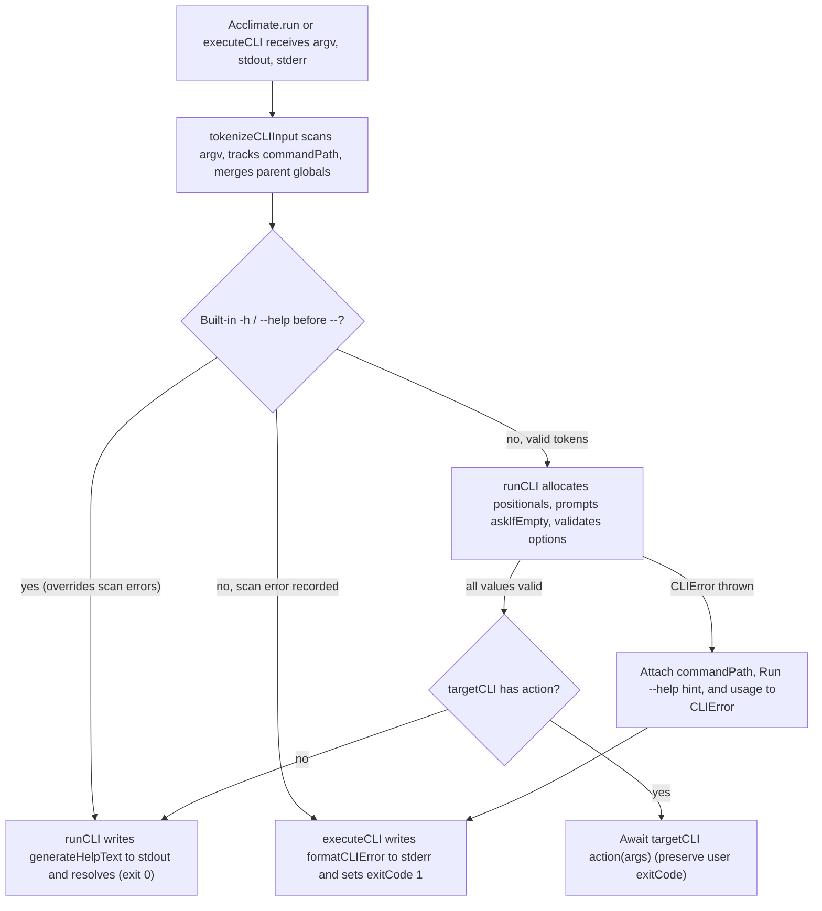
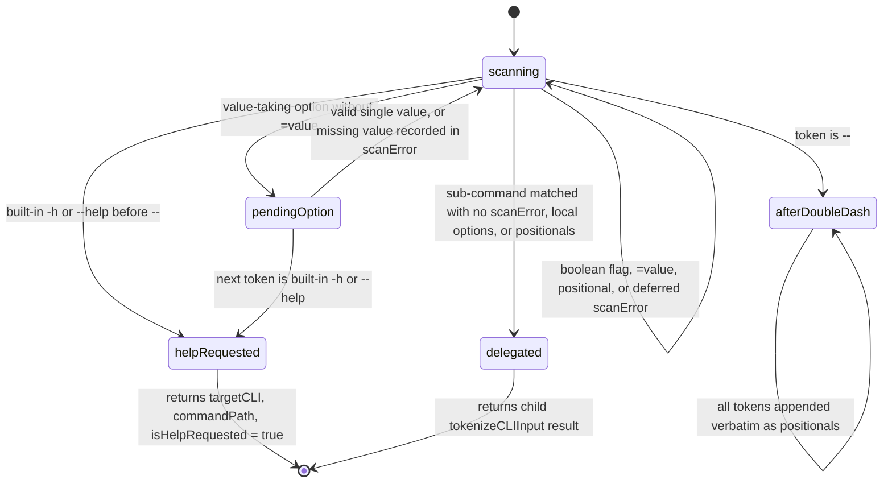

# First-Class Help Handling and Unknown-Flag Error Reporting

<small>

> <table border="0">
> <tr><th colspan="2">Files</th><th colspan="2">Lines</th></tr>
> <tr><td>Changed (total)</td><td>22</td><td>Insertions (+)</td><td>1,776</td></tr>
> <tr><td>Added</td><td>8</td><td>Deletions (-)</td><td>238</td></tr>
> <tr><td>Deleted</td><td>0</td><td>Net change</td><td>+1,538</td></tr>
> </table>

</small>

## 1. Purpose

Users invoking an Acclimate CLI with `-h` or `--help` could not read usage without triggering an error or executing command logic, because Acclimate had no built-in help flag<sup>G1</sup> recognition before argument validation, interactive prompts, or action callbacks. At the same time, running `Acclimate.run(cli)` with an unknown flag or missing required input produced an unhandled promise rejection with a Node.js stack trace and no recovery hint<sup>G7</sup> or usage output, forcing downstream CLIs to maintain a separate help pre-parser.

This change:

- Recognizes `-h` and `--help` at root and every nested sub-command before validation, prompts, other flag errors, or command actions run (§4).
- Expands help text with usage synopses, parameter choices, command examples, full command paths<sup>G2</sup>, and collision-aware built-in help flags<sup>G1</sup> (§5).
- Renders unknown flags and CLI usage errors with a recovery hint<sup>G7</sup> and command usage to `stderr` and exits with status `1` (§6).

## 2. Background technical context

```text
src/
├── index.ts                                       (changed)
├── Acclimate.ts                                   (changed)
├── CLIError.ts                                    (changed)
└── AcclimateCLI/
    ├── CLIParam.types.ts                          (changed)
    ├── AcclimateCLI.types.ts                      (changed)
    ├── AcclimateCLI.ts                            (changed)
    ├── createCLI/
    │   └── defaultCLIState.ts                     (changed)
    ├── generateHelpText/
    │   └── generateHelpText.ts                    (changed)
    ├── formatCLIError/                            (new)
    │   └── formatCLIError.ts
    ├── executeCLI/                                (new)
    │   └── executeCLI.ts
    └── runCLI/
        ├── attachCLIErrorHelpContext.ts           (new)
        ├── runCLI.ts                              (changed)
        └── tokenizeCLIInput/
            └── tokenizeCLIInput.ts                (changed)
```

<small>

| Unit | What it is |
| --- | --- |
| `src/index.ts` | Public package entry point. Exports `Acclimate`, `executeCLI`, `generateHelpText`, `CLIError`, and CLI builder and parameter types. |
| `Acclimate.ts` | Public facade exposing `createCLI`, `run`, `log`, and `requestInput`. `Acclimate.run` wires `process.argv.slice(2)`, `process.stdout`, `process.stderr`, and `process.exitCode` into `executeCLI`. |
| `CLIError.ts` | Structured error thrown for invalid CLI configuration, tokenization failures, missing required inputs, and value validation failures. Stores `code`, `cliName`, `commandPath`, `hint`, and `usage`. |
| `CLIParam.types.ts` | Shared parameter, `CLIExample`, and `OutputStream` types imported by `AcclimateCLI.types.ts` and re-exported at the package root. |
| `AcclimateCLI.types.ts` | Immutable fluent builder contract (`IAcclimateCLI`), internal `CLIState` snapshot, and argument type inference (`FullCLIArgValues`). |
| `AcclimateCLI.ts` | Immutable builder implementation created by `createCLI`, including `.usage(...)`, `.addExample(...)`, and async-compatible `.action(...)`. |
| `defaultCLIState.ts` | Initial empty `CLIState` template used by `createCLI`, seeding `usage: undefined` and `examples: []`. |
| `generateHelpText.ts` | Formats a CLI's full command path<sup>G2</sup>, purpose, usage synopsis, positional arguments, options, global options<sup>G5</sup>, choices, defaults, examples, and sub-commands into ANSI text. |
| `attachCLIErrorHelpContext.ts` | Shared helper called by `tokenizeCLIInput` and `runCLI` to attach a command's path, `--help` recovery hint<sup>G7</sup>, and generated usage text onto a `CLIError`. |
| `tokenizeCLIInput.ts` | Pure functional left-to-right token scanner that descends into sub-commands, merges parent global options<sup>G5</sup>, detects built-in `-h`/`--help`, and defers tokenization errors while checking for help. |
| `runCLI.ts` | Core command execution pipeline that short-circuits built-in help to `stdout`, parses and validates arguments, enriches post-tokenization `CLIError` instances, and awaits command actions. |
| `formatCLIError.ts` | Pure formatter that turns a `CLIError` into red error text, an indented yellow `⚠️` recovery hint<sup>G7</sup>, and the failing command's usage block for `stderr`. |
| `executeCLI.ts` | Process-boundary runner that invokes `runCLI`, formats caught `CLIError` instances onto `stderr` without a stack trace, and returns exit status `0` or `1`. |

</small>

## 3. Shape of the solution

Every CLI invocation now passes through a three-layer boundary separating tokenization and parsing (`tokenizeCLIInput` and `runCLI`), user-facing help and error formatting (`generateHelpText` and `formatCLIError`), and process exit handling (`executeCLI` called by `Acclimate.run`):



> *Built-in help flags<sup>G1</sup> short-circuit inside `runCLI` immediately after `tokenizeCLIInput`, preventing required-parameter errors, interactive prompts, and command actions from executing. Any `CLIError` raised during tokenization or parsing carries `commandPath`, `hint`, and `usage` so `executeCLI` writes formatted diagnostics exclusively to `stderr`.*

The three strands build on each other cleanly: §4 establishes built-in `-h`/`--help` detection, command path<sup>G2</sup> tracking, and zero-side-effect short-circuiting during tokenization and execution; §5 formats the complete usage document rendered both for `--help` on `stdout` and for error output on `stderr`; and §6 enriches `CLIError`, formats `stderr` diagnostics, and binds `Acclimate.run` to nonzero exit codes through `executeCLI`.

## 4. Built-in `-h` and `--help` take precedence over validation, prompts, errors, and actions

This strand implements built-in help recognition inside the existing schema-aware tokenizer rather than in a separate pre-parser, so sub-command dispatch, inherited global options<sup>G5</sup>, value-taking option arity, and the end-of-options separator<sup>G4</sup> `--` stay governed by one set of rules.

### 4.1 Token scanning defers flag errors until `--help` precedence is settled

`tokenizeCLIInput` in `src/AcclimateCLI/runCLI/tokenizeCLIInput/tokenizeCLIInput.ts` extends `TokenScanState` with `isHelpRequested` and `scanError`, and threads `commandPath` (seeded to `[cli.getName()]` and extended with each matched sub-command token) through recursive sub-command calls.



> *Once `helpRequested` is entered before `--`, subsequent tokens are ignored and any earlier `scanError` on the active command is discarded. When scanning ends without `isHelpRequested`, the first recorded `scanError` or dangling `pendingOption` throws an enriched `CLIError`.*

**File: `src/AcclimateCLI/runCLI/tokenizeCLIInput/tokenizeCLIInput.ts`**

```typescript {1-10}
function _isBuiltinHelpFlag(options: { cli: AnyCLI; token: string }): boolean {
  const { cli, token } = options;
  return (
    (token === "--help" || token === "-h") &&
    _findOptionEntry({ cli, rawFlag: "--help" }) === undefined &&
    (token === "--help" ||
      _findOptionEntry({ cli, rawFlag: "-h" }) === undefined)
  );
}
```

Checking `_findOptionEntry` inside `_isBuiltinHelpFlag` handles collision safety uniformly across both local options and inherited global options<sup>G5</sup>:

- If neither `--help` nor `-h` is registered on the active command, both trigger built-in help.
- If a command registers `-h` as an alias for another option (such as `--host, -h`), `-h` routes to `--host` while `--help` remains built-in help.
- If a command explicitly registers `--help`, Acclimate defers to that option instead of intercepting it.
- Inline `=value` assignments (such as `--format=--help`) and tokens after `--` (such as `coverage -- -h --help`) never satisfy exact `"-h"` / `"--help"` matching before `--`, so they pass through as option values or positional arguments.

Recording the first `unknown_option` or `missing_option_value` as a deferred scan error<sup>G3</sup> instead of throwing mid-scan preserves help precedence when a user appends `--help` after a typo (`avandar-lint coverage --bogus --help`) or after an incomplete option (`avandar-lint coverage --format --help`). Guarding `canMatchSubcommand` with `state.scanError === undefined` ensures `avandar-lint --bogus coverage` reports the unknown option on `avandar-lint` instead of silently descending into `coverage`.

### 4.2 Worked trace across help precedence and unknown-flag boundaries

| Input tokens | Tokenizer transitions | Result |
| --- | --- | --- |
| `["-v", "coverage", "--bogus", "--help"]` | 1. `-v` records root global `--verbose`. 2. `coverage` merges parent globals into `coverage` and recurses with `commandPath = ["avandar-lint", "coverage"]`. 3. `--bogus` records `scanError = unknown_option`. 4. `--help` matches `_isBuiltinHelpFlag` and sets `isHelpRequested = true`. | Returns `isHelpRequested: true` for `avandar-lint coverage`; `runCLI` writes `coverage` help with inherited `--verbose` to `stdout` and runs no action or prompt. |
| `["coverage", "--format", "--help"]` | 1. Descends into `coverage`. 2. `--format` enters `pendingOption`. 3. `--help` triggers `_isBuiltinHelpFlag` at the top of `_consumePendingOptionToken`, clearing `pendingOption` and setting `isHelpRequested = true`. | Returns `isHelpRequested: true` for `avandar-lint coverage`; does not fail with `missing_option_value`. |
| `["coverage", "--", "-h", "--help"]` | 1. Descends into `coverage`. 2. `--` sets `isAfterDoubleDash = true`. 3. `-h` and `--help` are appended verbatim to `rawPositionalArgs`. | Returns `isHelpRequested: false` with `rawPositionalArgs: ["-h", "--help"]`. |
| `["coverage", "--bogus"]` | 1. Descends into `coverage` with merged parent globals. 2. `--bogus` records `scanError` with `commandPath = ["avandar-lint", "coverage"]`, recovery hint<sup>G7</sup>, and `coverage` usage. 3. Input ends with `isHelpRequested = false`. | Throws enriched `CLIError` (`code: "unknown_option"`) before `runCLI` validates required args or prompts. |

### 4.3 `runCLI` short-circuits help to injectable `stdout` and awaits async actions

In `src/AcclimateCLI/runCLI/runCLI.ts`, `runCLI` now accepts an optional `stdout?: OutputStream` (defaulting to `process.stdout`). Immediately after `tokenizeCLIInput` returns `isHelpRequested: true`, `runCLI` writes `generateHelpText(targetCLI, { commandPath })` plus a trailing newline to `stdout` and returns before `_parseTargetArgs` runs. When no help flag is requested and `targetState.action` is defined, `runCLI` awaits `targetState.action(parsedArgs)` so asynchronous command callbacks settle before `executeCLI` resolves. When a command has no action configured, `runCLI` writes `generateHelpText(targetCLI, { commandPath })` to `stdout` so nested actionless commands display their full command path<sup>G2</sup>.

## 5. Help output includes usage synopses, choices, examples, and collision-aware built-in help

This strand adds optional command metadata (`.usage(...)` and `.addExample(...)`) on `IAcclimateCLI` and upgrades `generateHelpText` so root and sub-command help carry complete, self-contained documentation without changing `IAcclimateCLI`'s four generic parameters.

### 5.1 Optional `.usage()` and `.addExample()` metadata builders

`src/AcclimateCLI/CLIParam.types.ts` defines `CLIExample` (`string | { command: string; description?: string }`) and `OutputStream` (`{ write: (chunk: string) => unknown }`). `AcclimateCLI` implements immutable `.usage(usage: string)` and `.addExample(example: CLIExample)` methods backed by `state.usage` (`undefined` by default) and `state.examples` (`[]` by default). Existing CLI definitions require zero changes.

### 5.2 Auto-generated synopses, choices, examples, and level-1 built-in help rendering

`generateHelpText(cli, { commandPath? })` in `src/AcclimateCLI/generateHelpText/generateHelpText.ts` computes the command header from `commandPath.join(" ")` (falling back to `cli.getName()`) and formats:

- **Usage (level 1):** Uses `state.usage` when provided; otherwise builds `${displayName}` plus `<command>` (for an actionless parent with no positional arguments) or `[command]` (when sub-commands coexist with an action or positionals), each positional argument token (`<arg>`, `[arg]`, `<arg...>`, `[arg...]`), and `[options]`.
- **Choices and defaults:** `_formatParamLine` appends `[choices: a | b | c]` whenever `param.choices` is non-empty, followed by `[default: ...]` when `defaultValue` is set.
- **Built-in help option (level 1):** `_getBuiltinHelpOption` appends `--help, -h (boolean) optional - Show help for this command` to `Options` unless the command explicitly registered `--help`, and drops `-h` from the alias list whenever `-h` is already claimed by another option. Level-2 expanded sub-commands omit repeated built-in help rows and `Usage` blocks so root help stays scannable.
- **Examples (level 1):** `_formatExamplesSection` renders declared string examples and structured `{ command, description }` examples under `Examples`.

Because `@avandar/acclimate` is a headless Node.js library, the rendered terminal output for `avandar-lint coverage --help` is shown directly as text:

```text
avandar-lint coverage
  Check test coverage for target paths

Usage
  avandar-lint coverage <target> [paths...] [options]

Positional Arguments
  target (string) required - Primary target
  paths... (string[]) optional - Additional paths [default: ["."]]

Options
  --format, -f (string) required - Output format [choices: stylish | agent | json]
  --help, -h (boolean) optional - Show help for this command

Global Options
  --verbose, -v (boolean) optional - Verbose logging [default: false]

Examples
  avandar-lint coverage web src/a.ts --format json - Check web target with JSON output
```

## 6. Unknown flags and CLI usage errors write recovery hints and usage to `stderr` and exit nonzero

This strand separates structured error creation (`CLIError` and `attachCLIErrorHelpContext`) from terminal rendering (`formatCLIError`) and process exit reporting (`executeCLI` and `Acclimate.run`), keeping `runCLI` deterministic for callers that catch `CLIError` while giving real CLI binaries clean `stderr` diagnostics and exit code `1`.

### 6.1 Immutable help context on `CLIError`

`src/CLIError.ts` updates `CLIError.unknownOption`'s default message to `Unknown option "<flag>"`, stores `cliName`, `commandPath`, `hint`, `usage`, and the constructor's original options snapshot (`_options`), and exposes `error.withHelpContext({ commandPath, hint, usage })`. Reconstructing from `_options` updates `cliName` to `commandPath.join(" ")` without double-prefixing `❌ Error running ...` and leaves the original error unmodified.

Both `tokenizeCLIInput` (for `unknown_option` and `missing_option_value`) and `runCLI` (for post-tokenization failures such as `missing_required_positional_arg`, `missing_required_option`, `too_many_positional_args`, and `invalid_cli_param_value`) call `attachCLIErrorHelpContext` in `src/AcclimateCLI/runCLI/attachCLIErrorHelpContext.ts`, ensuring every invocation error carries one consistent recovery hint<sup>G7</sup>:

```text
Run <commandPath> --help to see available options and usage.
```

### 6.2 `formatCLIError` and `executeCLI` keep `stdout` clean and preserve action exit codes

`src/AcclimateCLI/formatCLIError/formatCLIError.ts` formats any `CLIError` with a red error line, an indented yellow `⚠️` recovery hint<sup>G7</sup> line when `error.hint` is present, and a blank-line-separated usage block when `error.usage` is present.

**File: `src/AcclimateCLI/executeCLI/executeCLI.ts`**

```typescript {1-24}
export async function executeCLI(
  options: Readonly<ExecuteCLIOptions>,
): Promise<number> {
  const stdout = options.stdout ?? process.stdout;
  const stderr = options.stderr ?? process.stderr;

  try {
    await runCLI({ cli: options.cli, input: options.input, stdout });
    return 0;
  } catch (error) {
    const errorOutput =
      error instanceof CLIError ? formatCLIError(error)
      : error instanceof Error ? (error.stack ?? error.message)
      : String(error);
    stderr.write(`${errorOutput}\n`);
    options.onExitCode?.(1);
    return 1;
  }
}
```

When `runCLI` resolves normally, `executeCLI` returns `0` without calling `options.onExitCode`, so an action that intentionally sets `process.exitCode` (for example exit code `2` on lint violations) is not overwritten. When `runCLI` rejects with a `CLIError`, `executeCLI` writes formatted error, hint, and usage text exclusively to `stderr`, never writes to `stdout`, never prints a raw internal stack trace, invokes `onExitCode?.(1)`, and returns `1`. `Acclimate.run(cli)` delegates to `executeCLI` with `process.argv.slice(2)`, `process.stdout`, `process.stderr`, and `onExitCode: (exitCode) => { process.exitCode = exitCode; }`, avoiding `process.exit()` so streams flush cleanly and keeping `Acclimate.run`'s `void` signature backwards-compatible with callers enforcing `@typescript-eslint/no-floating-promises`.

For `avandar-lint coverage --bogus`, `stdout` stays empty, exit code is `1`, and `stderr` receives:

```text
❌ Error running avandar-lint coverage: Unknown option "--bogus"
  ⚠️ Run avandar-lint coverage --help to see available options and usage.

avandar-lint coverage
  Check coverage

Usage
  avandar-lint coverage <paths...> [options]
...
```

## 7. Decisions

- **Detect `-h` and `--help` inside `tokenizeCLIInput` with deferred `scanError` rather than adding a separate pre-parser pass.** A separate pre-parser would have to duplicate sub-command dispatch, global-option arity rules (such as `--config coverage coverage --help`), `--` end-of-options handling, and user-registered `-h` collision checks. Keeping one scanner eliminates parser drift while letting `--help` override earlier flag errors on the active command. Reversal condition: split into a separate pass only if future help syntax requires non-local lookahead across parent and child commands.
- **Keep `runCLI` rejecting with enriched `CLIError` instances and handle `stderr` rendering plus exit codes in `executeCLI` / `Acclimate.run`.** Swallowing errors inside `runCLI` would break programmatic callers and existing tests that assert `CLIError` rejections and would couple core parsing to `process.exitCode`. Exporting `executeCLI` alongside `Acclimate.run` gives embedded callers and tests a deterministic `Promise<number>` boundary while keeping `Acclimate.run(cli)` returning `void` so existing callers do not hit `@typescript-eslint/no-floating-promises`. Reversal condition: merge the layers only in a major version if `Acclimate.run` becomes `async` across all consumers.
- **Treat `-h` and `--help` as built-in only when the command has not explicitly registered them.** Respecting an explicit `-h` alias (such as `--host, -h`) keeps existing CLIs working while leaving `--help` active, and respecting an explicit `--help` option preserves custom help handlers. Reversal condition: reserve `--help` unconditionally only if Acclimate introduces an explicit `disableHelp()` builder switch.
- **Do not hijack bare positional token `"help"` as an implicit sub-command.** Automatically treating `"help"` as a reserved sub-command would collide with CLIs whose first positional argument can legitimately be the word `"help"`. Reversal condition: add an opt-in `help` sub-command helper if downstream CLIs request one.
- **Split `tokenizeCLIInput.test.ts` into `tokenizeCLIInput/__tests__/` (`scanning` and `help` suites) and add dedicated `runCLI.help.test.ts` and `runCLI.errors.test.ts` files.** Keeping each test file focused holds every TypeScript file in the repository under 400 lines while separating tokenization, execution, and subprocess boundary coverage. Reversal condition: none; the split has no runtime impact.

## 8. Deliberately not handled

- **`NO_COLOR` / TTY color stripping inside `generateTerminalMessage`:** Terminal color toggling based on TTY status and `NO_COLOR` is left for a dedicated semantic-theme follow-up PR so existing `generateTerminalMessage` contracts stay unchanged here.
- **TTY-aware guard inside `requestTerminalInput`:** Non-TTY interactive prompt failure handling remains out of scope for this change.
- **Short-flag clustering (`-vh` for `-v -h`):** Remains intentionally unsupported because `CLIOptionAlias` allows multi-character single-dash aliases (`-${string}`).

<div style="page-break-before: always"></div>

## Appendix A. Manual testing

<small>

1. Install dependencies from the repository root if `node_modules/` is not yet populated:

   ```sh
   npm install
   ```

2. Run the targeted test suites covering `CLIError` help context<sup>G6</sup>, metadata builders, help formatting, error formatting, tokenization, `runCLI` help/errors, and `executeCLI` unit plus subprocess checks:

   ```sh
   npx vitest run src/AcclimateCLI/createCLI/createCLI.test.ts src/AcclimateCLI/generateHelpText/generateHelpText.test.ts src/AcclimateCLI/formatCLIError/formatCLIError.test.ts src/AcclimateCLI/runCLI/tokenizeCLIInput/__tests__/ src/AcclimateCLI/runCLI/__tests__/runCLI.help.test.ts src/AcclimateCLI/runCLI/__tests__/runCLI.errors.test.ts src/AcclimateCLI/executeCLI/executeCLI.test.ts
   ```

   Pass condition: all 8 targeted test files pass with 0 failures (68 tests).

3. Run the full verification gate (TypeScript compiler check, ESLint, full Vitest suite, and `tsup` ESM/CJS/DTS build):

   ```sh
   npm run type && npm run lint && npm test && npm run build
   ```

   Pass condition: `tsc --noEmit` exits `0`, `eslint .` exits `0`, all 15 test files (132 tests) pass, and `dist/index.js`, `dist/index.cjs`, `dist/index.d.ts`, and `dist/index.d.cts` build cleanly.

4. Verify built-in sub-command help writes complete usage to `stdout`, leaves `stderr` empty, skips required validation and actions, and exits `0`:

   ```sh
   npx tsx -e '
     import { Acclimate } from "./src";
     const cov = Acclimate.createCLI("coverage")
       .description("Check coverage")
       .addPositionalArg({ name: "paths", type: "string", required: true, variadic: true })
       .addOption({ name: "--format", aliases: ["-f"] as const, type: "string", required: false, choices: ["stylish", "json"] as const, defaultValue: "stylish" })
       .addExample("avandar-lint coverage src/")
       .action(() => { console.log("ACTION_RAN"); });
     const root = Acclimate.createCLI("avandar-lint")
       .addGlobalOption({ name: "--verbose", aliases: ["-v"] as const, type: "boolean", required: false, defaultValue: false })
       .addCommand("coverage", cov);
     Acclimate.run(root);
   ' -- avandar-lint coverage -h
   echo "EXIT=$?"
   ```

   - **Before this change:** `-h` threw an unhandled `CLIError` (`unknown_option`) with a Node.js stack trace (or in v0.4.0 ran the command action).
   - **Now:** `stdout` prints `avandar-lint coverage` help including `Usage`, `paths...`, `[choices: stylish | json]`, `--help, -h`, inherited `--verbose, -v`, and `Examples`, does not print `ACTION_RAN`, leaves `stderr` empty, and prints `EXIT=0`.

5. Verify unknown flags fail nonzero with recovery guidance and command usage on `stderr` and empty `stdout`:

   ```sh
   npx tsx -e '
     import { Acclimate } from "./src";
     const cov = Acclimate.createCLI("coverage")
       .description("Check coverage")
       .addPositionalArg({ name: "paths", type: "string", required: true, variadic: true })
       .action(() => { console.log("ACTION_RAN"); });
     const root = Acclimate.createCLI("avandar-lint").addCommand("coverage", cov);
     Acclimate.run(root);
   ' -- avandar-lint coverage --bogus
   echo "EXIT=$?"
   ```

   - **Before this change:** `Acclimate.run` leaked an unhandled promise rejection stack trace with no recovery hint<sup>G7</sup> or usage output (and in v0.4.0 silently ignored `--bogus`).
   - **Now:** `stdout` is empty, `stderr` prints `❌ Error running avandar-lint coverage: Unknown option "--bogus"`, `  ⚠️ Run avandar-lint coverage --help to see available options and usage.`, and `coverage` usage with no stack trace, and `EXIT=1`.

</small>

<div style="page-break-before: always"></div>

## Appendix B. Glossary

<small>

| Term | Meaning |
| --- | --- |
| **G1** Built-in help flag | Acclimate's automatic `-h` and `--help` flags recognized at root and every sub-command unless explicitly registered by the CLI author. |
| **G2** Command path | The sequence of root CLI name and matched sub-command tokens typed by the user (for example `["avandar-lint", "coverage"]`), used in help headers, usage synopses, and `--help` recovery hints<sup>G7</sup>. |
| **G3** Deferred scan error | A tokenization failure (`unknown_option` or `missing_option_value`) stored on `TokenScanState.scanError` instead of thrown immediately, so a later built-in `-h` or `--help` before `--` still prints help cleanly. |
| **G4** End-of-options separator | The literal `--` token in `argv` that ends flag and sub-command parsing so every subsequent token, including `-h` and `--help`, is treated verbatim as a positional argument. |
| **G5** Global option | A named CLI option registered with `addGlobalOption` on a parent CLI that is automatically inherited by every nested sub-command and included in sub-command help output. |
| **G6** Help context | The `commandPath`, recovery `hint`, and rendered `usage` attached to a `CLIError` via `withHelpContext` for user-facing `stderr` formatting. |
| **G7** Recovery hint | The indented yellow warning line (`⚠️ Run <cmd> --help to see available options and usage.`) printed beneath a `CLIError` message on `stderr` to tell the user how to discover valid syntax. |

</small>
