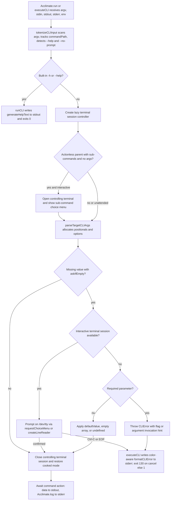
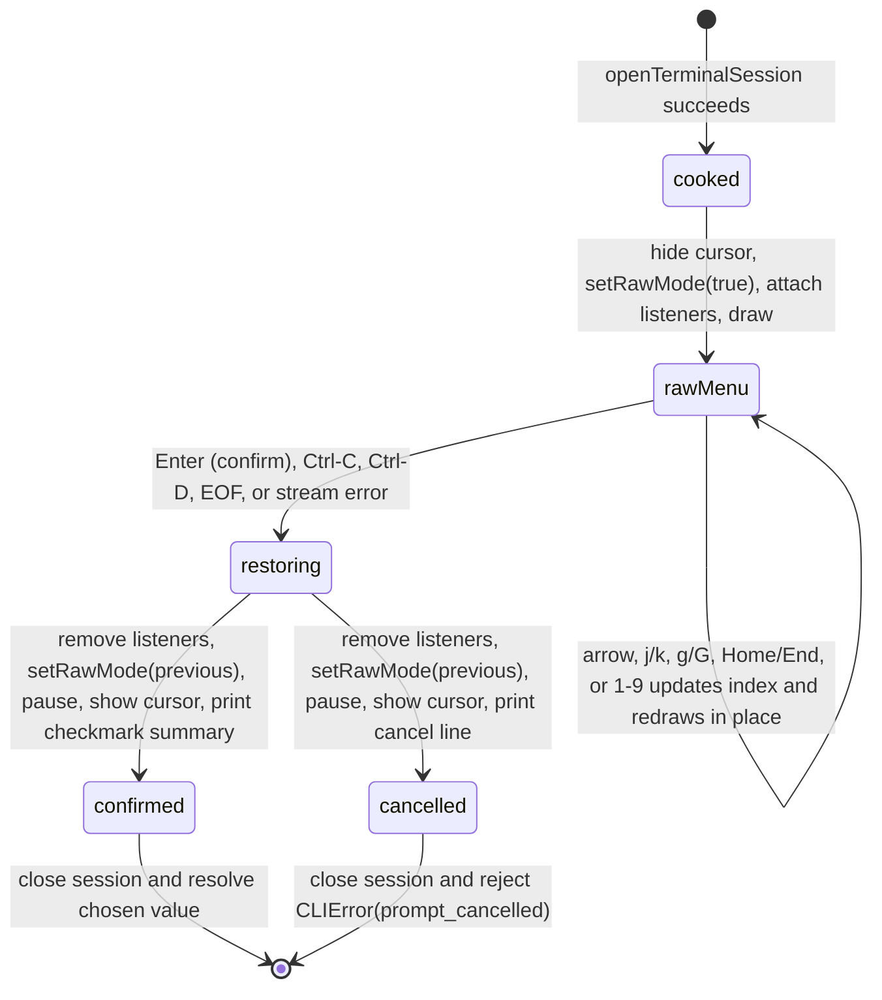

# Interactive Choice Menus, Controlling-Terminal Prompt IO, Unattended Fallback, and Stream Separation

<small>

> <table border="0">
> <tr><th colspan="2">Files</th><th colspan="2">Lines</th></tr>
> <tr><td>Changed (total)</td><td>43</td><td>Insertions (+)</td><td>4,423</td></tr>
> <tr><td>Added</td><td>23</td><td>Deletions (-)</td><td>959</td></tr>
> <tr><td>Deleted</td><td>0</td><td>Net change</td><td>+3,464</td></tr>
> </table>

</small>

## 1. Purpose

CLIs built with `@avandar/acclimate` could not safely mix interactive prompts with pipelines, CI jobs, or coding agents. `requestTerminalInput` read unconditionally from `process.stdin` and wrote prompts and validation errors to `process.stdout`, which consumed piped input as prompt answers, polluted JSON `stdout`, and hung non-TTY processes whenever an `askIfEmpty` parameter was missing. Acclimate also lacked arrow and Vim choice menus for discrete options, booleans, and bare multi-command roots, and `Acclimate.log` wrote diagnostic chatter to `stdout`.

This change:

- Isolates interactive prompt IO on the controlling terminal<sup>G3</sup> so piped `stdin` and data `stdout` remain untouched (§4).
- Adds choice menus with arrow and `j`/`k` wrapping, `g`/`G` jumps, bold-green `❯` selection, and raw-mode restoration on exit (§5).
- Adds built-in `--no-prompt`, bare sub-command selection menus, and fast unattended fallback with flag hints for missing required inputs (§6).
- Separates `stdout` machine data from `stderr` diagnostics and maps prompt cancellation to exit status `130` (§7).

## 2. Background technical context

```text
src/
├── index.ts                                       (changed)
├── Acclimate.ts                                   (changed)
├── CLIError.ts                                    (changed)
├── generateTerminalMessage/
│   └── generateTerminalMessage.ts                 (changed)
├── terminalSession/                               (new)
│   ├── terminalSession.types.ts
│   ├── isColorEnabledForStream/
│   │   └── isColorEnabledForStream.ts
│   ├── openTerminalSession/
│   │   └── openTerminalSession.ts
│   └── createLineReader/
│       └── createLineReader.ts
├── requestChoiceMenu/                             (new)
│   ├── requestChoiceMenu.types.ts
│   ├── MenuNavigation/
│   │   └── MenuNavigation.ts
│   ├── renderChoiceMenu/
│   │   └── renderChoiceMenu.ts
│   ├── runPlainChoiceMenu.ts
│   └── requestChoiceMenu.ts
├── requestTerminalInput/
│   └── requestTerminalInput.ts                    (changed)
└── AcclimateCLI/
    ├── formatCLIError/
    │   └── formatCLIError.ts                      (changed)
    ├── executeCLI/
    │   └── executeCLI.ts                          (changed)
    └── runCLI/
        ├── attachCLIErrorHelpContext.ts           (changed)
        ├── parseTargetCLIArgs.ts                  (new)
        ├── promptCLIParam/                        (new)
        │   └── promptCLIParam.ts
        ├── runCLI.ts                              (changed)
        └── tokenizeCLIInput/
            ├── cliOptionLookupHelpers.ts          (new)
            └── tokenizeCLIInput.ts                (changed)
```

<small>

| Unit                           | What it is                                                                                                                                                                                                     |
| ------------------------------ | -------------------------------------------------------------------------------------------------------------------------------------------------------------------------------------------------------------- | ------- | ---------------------------------------------------------------------------------------------- |
| `src/index.ts`                 | Public package entry point. Exports `Acclimate`, `executeCLI`, `generateHelpText`, `CLIError`, `requestChoiceMenu`, `requestTerminalInput`, `openTerminalSession`, `isColorEnabledForStream`, and their types. |
| `src/Acclimate.ts`             | Public facade wiring `createCLI`, `run`, `log` (to `stderr`), `writeData` and `writeJson` (to `stdout`), `requestInput`, and `requestChoice`.                                                                  |
| `src/CLIError.ts`              | Structured CLI error adding `prompt_cancelled` and `interactive_input_unavailable` codes plus optional recovery `hint` parameters on missing-required factories.                                               |
| `generateTerminalMessage.ts`   | Formats `$varName$` interpolation and `                                                                                                                                                                        | <COLOR> | `tokens, now supporting`bold`and`{ color?: boolean }` plain-mode<sup>G6</sup> token stripping. |
| `terminalSession.types.ts`     | Shared contracts (`TerminalInputStream`, `TerminalOutputStream`, `TerminalSession`, `TerminalSessionOptions`) for injectable and real controlling-terminal IO.                                                 |
| `isColorEnabledForStream.ts`   | Pure check returning `true` only when a stream is a TTY, `NO_COLOR` is empty or unset, and `TERM` is not `"dumb"`.                                                                                             |
| `openTerminalSession.ts`       | Acquires a controlling terminal<sup>G3</sup> (`/dev/tty`) guarded by attached-TTY and `CI` checks, falling back to `stdin` and `stderr` only when both are TTYs.                                               |
| `createLineReader.ts`          | Wraps a terminal session in a queued `node:readline` async iterator that preserves multi-line input and converts `SIGINT` or `EOF` to `CLIError.promptCancelled`.                                              |
| `MenuNavigation.ts`            | Pure raw key-chunk parser and wrapping index reducer handling arrow keys, `j`/`k`/`g`/`G`, `Home`/`End`, digits `1`-`9`, `Enter`, `Ctrl-C`, `Ctrl-D`, and split escape sequences.                              |
| `renderChoiceMenu.ts`          | Pure menu renderer highlighting the active item in bold bright green with a textual `❯` cursor, or plain text when color is disabled.                                                                          |
| `runPlainChoiceMenu.ts`        | Numbered plain-text fallback menu used when raw mode<sup>G7</sup> is unsupported (such as `TERM=dumb`), re-prompting on invalid answers.                                                                       |
| `requestChoiceMenu.ts`         | Orchestrates raw-mode menu rendering, keypress handling, and guaranteed restoration of raw mode<sup>G7</sup>, cursor visibility, and listeners on confirm, cancel, or error.                                   |
| `requestTerminalInput.ts`      | Interactive prompt helper delegating `choices` and raw-TTY `boolean` prompts to `requestChoiceMenu`, using `createLineReader` for text and numbers, and applying unattended fallback.                          |
| `cliOptionLookupHelpers.ts`    | Shared tokenizer helpers extracted from `tokenizeCLIInput` for flag lookup, built-in help detection, inline `=` splitting, and parent global option merging.                                                   |
| `tokenizeCLIInput.ts`          | Left-to-right token scanner extended to recognize built-in and explicitly declared `--no-prompt` flags and propagate `isNoPromptRequested` into sub-commands.                                                  |
| `promptCLIParam.ts`            | Prompts for a missing `askIfEmpty` CLI parameter over the active terminal session, or throws an actionable flag or argument error when unattended and required.                                                |
| `parseTargetCLIArgs.ts`        | Extracted positional, variadic, option, and global-option allocation and validation pipeline called by `runCLI`.                                                                                               |
| `runCLI.ts`                    | Command execution orchestrator managing the lazy single terminal session, bare multi-command selection menu, argument parsing, and session shutdown prior to running actions.                                  |
| `attachCLIErrorHelpContext.ts` | Enriches thrown `CLIError` instances with `commandPath`, preserves explicit unattended hints, and omits full usage dumps for `prompt_cancelled`.                                                               |
| `formatCLIError.ts`            | Renders `CLIError` messages, indented yellow recovery hints, and usage blocks with optional `{ color?: boolean }` plain-mode<sup>G6</sup> stripping.                                                           |
| `executeCLI.ts`                | Process-boundary runner forwarding terminal and environment options to `runCLI`, formatting errors to `stderr` with stream-aware color, and returning exit status `0`, `130`, or `1`.                          |

</small>

## 3. Shape of the solution

Every CLI invocation now separates interactive prompt IO onto a lazily opened controlling terminal<sup>G3</sup>, keeps command data strictly on `stdout`, and routes diagnostics and errors to `stderr`:



> _Explicit CLI values never open the controlling terminal<sup>G3</sup>. Whenever a menu or prompt does open a terminal session, `runCLI` closes it and restores cooked mode<sup>G4</sup> in `finally` before invoking the command action, leaving piped `stdin` untouched and `stdout` exclusively for command output._

The four strands stack cleanly from low-level terminal IO up to the process boundary: §4 establishes controlling-terminal opening, queued line reading, and plain-mode<sup>G6</sup> color gating; §5 builds the pure choice-menu engine and migrates `requestTerminalInput` onto it; §6 integrates built-in `--no-prompt`, bare command selection, and unattended fallback into `tokenizeCLIInput` and `runCLI`; and §7 enforces `stdout`/`stderr` stream separation across `Acclimate`, `formatCLIError`, and `executeCLI`.

## 4. Controlling-terminal sessions isolate interactive prompts from piped `stdin` and data `stdout`

This strand replaces direct reads from `process.stdin` and writes to `process.stdout` with a centralized `terminalSession` layer so pipelines such as `cat payload.json | tool --format json | jq .` can still prompt a human without corrupting either end of the pipe, while non-interactive scripts and agents never hang.

### 4.1 Attached-TTY guard prevents unattended subprocesses from hijacking `/dev/tty`

On macOS and Linux, a child process spawned with piped `stdin`, `stdout`, and `stderr` (such as `execFile` in tests, background jobs, or coding-agent tool calls) often still inherits the parent shell's controlling terminal<sup>G3</sup> at `/dev/tty`. Opening `/dev/tty` unconditionally would block unattended callers waiting for keyboard input no one can supply.

**File: `src/terminalSession/openTerminalSession/openTerminalSession.ts`**

```typescript {11-14,21}
export async function openTerminalSession(
  options: Readonly<TerminalSessionOptions> = {},
): Promise<TerminalSession | undefined> {
  ...
  const isForceInteractive = options.interactive === true;
  const isCiEnvironment = env.CI === "true" || env.CI === "1";
  if (!isForceInteractive && isCiEnvironment) {
    return undefined;
  }

  const hasAttachedTty = Boolean(stdin.isTTY || stdout.isTTY || stderr.isTTY);
  if (!isForceInteractive && !hasAttachedTty) {
    return undefined;
  }

  const ttySession =
    options.openTty ?
      await options.openTty()
    : await _openPosixTtySession(env);

  return ttySession ?? _makeFallbackTtySession({ stdin, stderr, env });
}
```

The highlighted attached-TTY guard<sup>G1</sup> checks whether at least one standard stream is still connected to a terminal before attempting to open `/dev/tty`, and `_makeFallbackTtySession` falls back to `stdin` and `stderr` only when both are TTYs:

| Invocation shape                                                      | `stdin.isTTY` | `stdout.isTTY` | `stderr.isTTY` | Session acquired                               |
| --------------------------------------------------------------------- | ------------- | -------------- | -------------- | ---------------------------------------------- |
| Direct terminal (`tool`)                                              | `true`        | `true`         | `true`         | `/dev/tty` (fallback: `stdin` + `stderr`)      |
| Redirected data (`tool > out.json`)                                   | `true`        | `false`        | `true`         | `/dev/tty` (fallback: `stdin` + `stderr`)      |
| Piped input and output (`cat in \| tool \| jq`)                       | `false`       | `false`        | `true`         | `/dev/tty` (never falls back to piped `stdin`) |
| Fully piped agent or CI (`execFile`, `tool < /dev/null > out 2> err`) | `false`       | `false`        | `false`        | `undefined` (unattended fail-fast)             |
| `CI=true` or `--no-prompt` or `interactive: false`                    | any           | any            | any            | `undefined` (unattended fail-fast)             |

When `_openPosixTtySession` opens `/dev/tty`, it opens two separate file descriptors asynchronously via promisified `node:fs` `open` (`O_RDONLY` for `tty.ReadStream` and `O_WRONLY` for `tty.WriteStream`) so destroying both streams on `close()` closes each descriptor once without double-closing a shared descriptor. If either open or stream constructor throws, `_closeDescriptorQuietly` releases any already-opened raw descriptor.

### 4.2 Queued line reading and plain-mode color gating

Repeated calls to `readline/promises` `.question()` drop subsequent lines when multiple lines arrive in one buffered chunk (for example pasted multi-line input or deterministic `PassThrough` test streams), because Node's `readline` emits all queued `"line"` events before the next `.question()` microtask attaches. `createLineReader` in `src/terminalSession/createLineReader/createLineReader.ts` instead consumes `readlineInterface[Symbol.asyncIterator]()`, which buffers queued lines in FIFO order, adapts minimal `{ write }` output streams into a Node `Writable`, writes prompts exclusively to `session.output`, and listens for `SIGINT` so both `Ctrl-C` and stream `EOF` reject with `CLIError.promptCancelled`.

`isColorEnabledForStream` returns `true` only when `stream.isTTY === true`, `NO_COLOR` is unset or empty, and `TERM !== "dumb"`. `generateTerminalMessage` adds `bold` (`\x1b[1m`) to `COLOR_CODES` and accepts an optional third `{ color?: boolean }` parameter (defaulting to `true` for backwards compatibility); when `color` is `false`, known `|<COLOR>|` tokens are stripped cleanly without emitting ANSI escapes or a trailing reset sequence.

## 5. Interactive choice menus support arrow and Vim navigation and always restore raw terminal mode

This strand introduces a zero-dependency choice menu subsystem split into pure navigation (`MenuNavigation`), pure rendering (`renderChoiceMenu`), plain fallback (`runPlainChoiceMenu`), and raw-mode orchestration (`requestChoiceMenu`), then delegates `choices` and raw-TTY `boolean` prompts from `requestTerminalInput` into it.

### 5.1 Raw-mode terminal lifecycle guarantees state restoration on every exit path

In raw mode<sup>G7</sup>, a terminal disables local echo, line buffering, and OS-level `SIGINT` translation. Leaving raw mode active or the cursor hidden after a prompt finishes or errors leaves the user's shell unusable.



> _Every terminal exit path passes through one idempotent cleanup routine (`_restoreRawTerminalState`) that removes `data`/`end`/`close`/`error` listeners, restores the prior `isRaw` boolean, pauses the input stream, and emits `\x1b[?25h` to make the cursor visible again before resolving or rejecting._

### 5.2 Split escape buffering and wrapping navigation in `MenuNavigation`

Raw terminal input can deliver a single escape sequence split across two `data` chunks (such as `"\x1b"` followed by `"[B"`) or multiple keypresses coalesced in one chunk (such as `"kjGg\x1b[B\r"`).

**File: `src/requestChoiceMenu/MenuNavigation/MenuNavigation.ts`**

```typescript {8-12,28-33}
export const MenuNavigation = {
  parseKeyChunk: (
    chunk: string,
    pendingEscapeBuffer: string = "",
  ): ParsedMenuKeyChunk => {
    const combined = `${pendingEscapeBuffer}${chunk}`;
    ...
      if (char === "\x1b") {
        const escapeMatch = _matchEscapeAt(combined, cursor);
        if (escapeMatch.isIncomplete) {
          return { events, pendingEscapeBuffer: combined.slice(cursor) };
        }
        if (escapeMatch.event) {
          events.push(escapeMatch.event);
        }
        cursor += escapeMatch.consumed;
        continue;
      }
      ...
  },

  stepIndex: (options: {
    selectedIndex: number;
    numChoices: number;
    event: Readonly<MenuKeyEvent>;
  }): number => {
    ...
    if (event.kind === "up") {
      return (selectedIndex - 1 + numChoices) % numChoices;
    }
    if (event.kind === "down") {
      return (selectedIndex + 1) % numChoices;
    }
    ...
  },
};
```

When a chunk ends with an incomplete escape prefix (`\x1b`, `\x1b[`, `\x1bO`, `\x1b[1`, or `\x1b[4`), `parseKeyChunk` returns it in `pendingEscapeBuffer` so the next chunk completes the sequence without triggering spurious cancellations. Worked traversal for a three-item list `["stylish", "agent", "json"]` starting at index `0`:

| Input chunk          | Parsed events                   | Pending buffer      | Resulting index / outcome    |
| -------------------- | ------------------------------- | ------------------- | ---------------------------- |
| `"k"`                | `[{ kind: "up" }]`              | `""`                | Wraps `0 -> 2` (`"json"`)    |
| `"j"`                | `[{ kind: "down" }]`            | `""`                | Wraps `2 -> 0` (`"stylish"`) |
| `"G"`                | `[{ kind: "last" }]`            | `""`                | Jumps to `2` (`"json"`)      |
| `"g"`                | `[{ kind: "first" }]`           | `""`                | Jumps to `0` (`"stylish"`)   |
| `"\x1b"` then `"[B"` | `[]`, then `[{ kind: "down" }]` | `"\x1b"`, then `""` | Moves `0 -> 1` (`"agent"`)   |
| `"\r"`               | `[{ kind: "confirm" }]`         | `""`                | Resolves `"agent"`           |

### 5.3 Visual layout, plain fallback, and `requestTerminalInput` delegation

Because `@avandar/acclimate` is a headless Node.js library, the rendered choice menu is shown directly as terminal text. On a color-capable TTY, the active row renders in bold bright green (`\x1b[1m\x1b[92m`) with a textual `❯` cursor; on confirm, the menu block is erased in place and replaced with a single checkmark summary line:

```text
? Output format (↑/↓ or j/k to move, g/G first/last, Enter to select)
  stylish (default) - Human summary
❯ json - Machine output

(After Enter:)
✔ Output format: json
```

When `session.isRawModeSupported` is `false` (for example under `TERM=dumb`), `requestChoiceMenu` delegates to `runPlainChoiceMenu`, which writes a numbered plain list (`1. stylish`, `2. json`) with no ANSI cursor controls, reads via `createLineReader`, rejects invalid input with an explicit retry message instead of accepting a prior default, and cancels on `EOF`.

`requestTerminalInput` now opens or reuses a `TerminalSession`, delegates any parameter with `choices` to `requestChoiceMenu` (adding a `(skip)` item when optional with no `defaultValue`), delegates `type: "boolean"` on raw-capable TTYs to a `Yes`/`No` choice menu, validates required text, `(y/n)` plain booleans, numeric syntax, and custom `validate` rules on `session.output`, and applies unattended fallback (returning stringified `defaultValue` or `undefined` when optional, or throwing `CLIError.interactiveInputUnavailable` when required).

## 6. Built-in `--no-prompt`, bare sub-command selection, and unattended fallback prevent automation hangs

This strand connects the terminal session and menu engine into `tokenizeCLIInput` and `runCLI` so humans get automatic command and option menus while CI, scripts, and agents get deterministic unattended execution.

### 6.1 Built-in `--no-prompt` without breaking explicitly declared flags

`tokenizeCLIInput` tracks `isNoPromptRequested` on `TokenScanState` and `TokenizedCLIInput`, propagating `inheritedNoPrompt` across sub-command delegation:

- If a command does not register `--no-prompt`, passing `--no-prompt` or `--no-prompt=true` before `--` sets `isNoPromptRequested = true` without throwing `unknown_option` and without adding an undeclared `noPrompt` key to `action(args)`. `--no-prompt=false` sets it to `false`.
- If a downstream CLI explicitly registers `--no-prompt` via `addOption` or `addGlobalOption`, the option is recorded into `rawOptionArgs` or `rawGlobalOptionArgs` as usual (so `action(args)` still receives `noPrompt`) while also mirroring `rawValue !== "false"` into `isNoPromptRequested`.
- After `--`, `--no-prompt` passes through verbatim as a positional argument.

### 6.2 Lazy single-session lifecycle, bare multi-command menus, and unattended errors

`runCLI` creates one lazy terminal controller<sup>G5</sup> (`_createLazyTerminalController`) whose `getSession()` calls `openTerminalSession` at most once and only when a bare command menu or `askIfEmpty` parameter actually needs user input. When `options.interactive === false` or `tokenized.isNoPromptRequested === true`, `effectiveInteractive` is forced to `false` so `/dev/tty` is never opened.

**File: `src/AcclimateCLI/runCLI/runCLI.ts`**

```typescript {11-17,21-23}
async function _collectTargetExecution(options: {
  initialContext: Readonly<TargetExecutionContext>;
  terminalController: Readonly<LazyTerminalController>;
}): Promise<{
  finalContext: TargetExecutionContext;
  parsedArgs: Record<string, CLIParamDataType>;
}> {
  const { terminalController } = options;
  let finalContext: TargetExecutionContext = options.initialContext;

  try {
    finalContext = await _selectBareSubcommand({
      context: options.initialContext,
      getTerminalSession: terminalController.getSession,
    });
    const targetState = finalContext.targetCLI.state as RuntimeTargetCLIState;
    const parsedArgs = await parseTargetCLIArgs({ ... });
    return { finalContext, parsedArgs };
  } catch (error: unknown) {
    ...
  } finally {
    await terminalController.close();
  }
}
```

Closing `terminalController` in `finally` inside `_collectTargetExecution` guarantees that any opened `/dev/tty` session is restored to cooked mode<sup>G4</sup> and closed before `matchedState.action(parsedArgs)` executes.

When an actionless parent or group command has registered sub-commands and receives no positional arguments or local options, `_selectBareSubcommand` checks for an interactive terminal session:

- **Interactive:** opens a choice menu listing alphabetically sorted sub-commands with their descriptions, merges parent global options into the chosen sub-command via `mergeParentGlobalOptions`, carries forward `rawGlobalOptionArgs`, appends the chosen command to `commandPath`, and recurses so nested command groups and the selected command's `askIfEmpty` prompts run in one flow.
- **Unattended:** returns the actionless command unchanged, preserving the existing behavior of writing help text to `stdout`.

During argument parsing in `parseTargetCLIArgs`, any missing `askIfEmpty` parameter calls `promptCLIParam`. When no terminal session is available:

- Optional parameters return `undefined`, allowing `defaultValue`, `[]` (for optional variadic args), or `undefined` to take effect without hanging.
- Required parameters immediately throw `CLIError.missingRequiredOption` or `CLIError.missingRequiredPositionalArg` with an explicit unattended message and an actionable recovery hint naming the exact flag or argument and example invocation (for example `Pass --format <value> (for example: avandar-lint coverage --format <value>) or run avandar-lint coverage --help.`). `attachCLIErrorHelpContext` preserves that explicit `error.hint` while attaching full command usage.

## 7. Strict stream separation keeps machine data on `stdout`, diagnostics on `stderr`, and maps cancellation to exit code `130`

This strand aligns `Acclimate`, `formatCLIError`, and `executeCLI` with the contract that `stdout` carries only intentional machine data (plus explicit `-h`/`--help`) while conversational chatter, warnings, errors, and cancellations go exclusively to `stderr`:

- **`Acclimate.log(message, params?, options?)`** writes to `options?.stream ?? process.stderr` instead of `console.log`, computing color via `isColorEnabledForStream` so redirected `stderr`, `NO_COLOR`, and `TERM=dumb` produce clean plain text.
- **`Acclimate.writeData(data, options?)`** and **`Acclimate.writeJson(value, options?)`** write clean text or serialized JSON strictly to `stdout` without ANSI escapes or diagnostic chatter.
- **`Acclimate.requestChoice(options)`** exposes `requestChoiceMenu` directly on the `Acclimate` facade, and `src/index.ts` exports `requestChoiceMenu`, `requestTerminalInput`, `openTerminalSession`, `isColorEnabledForStream`, and their types.
- **`executeCLI`** forwards `stdin`, `stderr`, `env`, `terminal`, `interactive`, and `openTty` to `runCLI`, formats caught `CLIError` values via `formatCLIError(error, { color: isColorEnabledForStream({ stream: stderr, env }) })`, and maps `error.code === "prompt_cancelled"` to exit code `130` (matching POSIX `128 + SIGINT`) while keeping exit code `1` for all other failures. Because `attachCLIErrorHelpContext` omits the full usage block for `prompt_cancelled`, hitting `Ctrl-C` prints one concise cancellation line on `stderr`, leaves `stdout` empty, and exits `130`.

## 8. Decisions

- **Guard `/dev/tty` behind `stdin.isTTY || stdout.isTTY || stderr.isTTY` and `CI` detection rather than probing `/dev/tty` unconditionally.** Child processes spawned via `execFile` or redirected pipelines inside a developer shell inherit the parent's controlling terminal<sup>G3</sup>, so unconditional `/dev/tty` opening would hang unattended automation while keeping `stderr.isTTY === true` still lets `cat in | tool | jq` open `/dev/tty` interactively. Reversal condition: add an explicit opt-in force-TTY flag only if a consumer runs prompts with all three standard streams intentionally redirected.
- **Implement the choice menu engine with Node built-ins rather than adding `@clack/prompts` or `inquirer`.** Adding a third-party prompt dependency would expand runtime dependencies against `docs/rules/node.md` and still require custom wrappers for `j`/`k` wrapping, `g`/`G` jumps, bold-green `❯` rendering, and `/dev/tty` isolation when `stdin` and `stdout` are both piped. Reversal condition: adopt an external TUI library only if Acclimate expands into multi-pane full-screen terminal widgets.
- **Open `/dev/tty` with separate `O_RDONLY` and `O_WRONLY` file descriptors rather than sharing one `O_RDWR` descriptor across `ReadStream` and `WriteStream`.** Sharing one numeric descriptor causes `destroy()` on both streams to double-close the same OS descriptor and can trigger `EBADF` or close a reused descriptor. Reversal condition: switch to a single duplex stream only if Node.js exposes a first-class duplex `/dev/tty` constructor.
- **Read line prompts through `readlineInterface[Symbol.asyncIterator]()` inside `createLineReader` rather than repeated `readline/promises` `.question()` calls.** Repeated `.question()` calls drop queued lines when multiple lines arrive in one buffered chunk or pasted input, causing hangs in both pasted interactive input and stream tests. Reversal condition: return to `.question()` only if Node's `readline/promises` buffers unread lines across calls.
- **Recognize `--no-prompt` natively in `tokenizeCLIInput` while still honoring explicitly declared `--no-prompt` options.** Downstream CLIs (such as `avandar-lint`) may already declare `--no-prompt` and read `args.noPrompt`, whereas other CLIs rely on Acclimate providing unattended mode<sup>G8</sup> automatically without adding unexpected keys to `action(args)`. Reversal condition: require every CLI to declare `--no-prompt` explicitly only in a breaking major version.
- **Map `prompt_cancelled` to exit status `130` with a concise `stderr` line (no full usage block) rather than exit status `1` with full usage.** Printing a full `--help` block when a user intentionally cancels a menu with `Ctrl-C` adds noise, and exit code `130` lets scripts distinguish user cancellation from usage errors (`1`). Reversal condition: standardize on exit code `1` only if a cross-CLI convention requires collapsing cancellation into generic failure.
- **Move `Acclimate.log` from `stdout` to `stderr` and add `Acclimate.writeData` and `Acclimate.writeJson` for `stdout`.** Writing formatted logs to `stdout` breaks piped JSON consumers whenever a command logs progress, while `writeData` and `writeJson` give authors an explicit data-stream channel. Reversal condition: none; callers needing `stdout` logs can pass `{ stream: process.stdout }` or use `Acclimate.writeData`.

## 9. Deliberately not handled

- **Full semantic theme customization (`Acclimate.setTheme`, `printSuccess`, `printWarn`, `printError`):** Reserved for a dedicated semantic-theme follow-up PR so PR 3 stays focused on interactive menus, `/dev/tty`, unattended mode<sup>G8</sup>, and stream separation.
- **Multi-select checkbox menus or fuzzy text-filterable menus:** Only single-select choice menus (options with `choices`, booleans, bare sub-command menus<sup>G2</sup>, and `Acclimate.requestChoice`) are in scope here.
- **Interactive prompts for parameters without `askIfEmpty`:** Required parameters that do not set `askIfEmpty` keep their existing immediate-error contract rather than unexpectedly prompting existing callers.

<div style="page-break-before: always"></div>

## Appendix A. Manual testing

<small>

1. Install dependencies from the repository root if `node_modules/` is missing:

   ```sh
   npm install
   ```

2. Run the targeted test suites covering terminal sessions, choice menus, terminal input, `--no-prompt`, interactive `runCLI`, stream separation, and subprocess boundaries:

   ```sh
   npx vitest run src/terminalSession/ src/requestChoiceMenu/ src/requestTerminalInput/ src/AcclimateCLI/runCLI/ src/AcclimateCLI/executeCLI/ src/__tests__/acclimateStreams.integration.test.ts
   ```

   Pass condition: all 21 targeted test files pass with 0 failures.

3. Run the full verification gate (TypeScript type check, ESLint, full Vitest suite, and `tsup` dual ESM/CJS/DTS build):

   ```sh
   npm run type && npm run lint && npm test && npm run build
   ```

   Pass condition: `tsc --noEmit` exits `0`, `eslint .` exits `0`, all 26 test files (187 tests) pass, and `dist/index.js`, `dist/index.cjs`, `dist/index.d.ts`, and `dist/index.d.cts` build cleanly.

4. Verify clean JSON `stdout` alongside `Acclimate.log` diagnostics on `stderr` in a non-TTY pipeline:

   ```sh
   npx tsx -e '
     import { Acclimate } from "./src";
     const cli = Acclimate.createCLI("report")
       .addOption({
         name: "--format",
         type: "string",
         required: false,
         choices: ["stylish", "json"] as const,
         defaultValue: "json",
         askIfEmpty: true,
       })
       .action(({ format }) => {
         Acclimate.log("|cyan|Building report...|reset|");
         Acclimate.writeJson({ format, status: "ok" });
       });
     Acclimate.run(cli);
   ' -- report 2> /tmp/acclimate-stderr.txt | node -e 'const data = JSON.parse(require("node:fs").readFileSync(0, "utf8")); console.log("PARSED:", data.format, data.status);'
   cat /tmp/acclimate-stderr.txt
   ```

   - **Before this change:** `Acclimate.log` wrote ANSI-colored text to `stdout`, breaking `JSON.parse`, and `askIfEmpty` attempted to prompt on piped `stdin`.
   - **Now:** `stdout` parses cleanly as JSON (`PARSED: json ok`) and `/tmp/acclimate-stderr.txt` contains plain-text `Building report...` with zero ANSI escapes.

5. Verify unattended fail-fast for a missing required `askIfEmpty` option when all streams are redirected:

   ```sh
   npx tsx -e '
     import { Acclimate } from "./src";
     const cli = Acclimate.createCLI("deploy")
       .addOption({
         name: "--env",
         type: "string",
         required: true,
         choices: ["dev", "prod"] as const,
         askIfEmpty: true,
       })
       .action(({ env }) => {
         Acclimate.writeJson({ env });
       });
     Acclimate.run(cli);
   ' -- deploy < /dev/null > /tmp/acclimate-out.txt 2> /tmp/acclimate-err.txt
   echo "EXIT=$?"
   cat /tmp/acclimate-out.txt
   cat /tmp/acclimate-err.txt
   ```

   - **Before this change:** The process read from redirected `stdin` or hung instead of reporting the missing flag.
   - **Now:** Exits immediately with `EXIT=1`, `/tmp/acclimate-out.txt` is empty, and `/tmp/acclimate-err.txt` reports the missing `--env` flag with the recovery hint `Pass --env <value> (for example: deploy --env <value>) or run deploy --help.` plus full usage.

6. Verify interactive choice menus, bare multi-command selection, and `Ctrl-C` raw-mode restoration in a real terminal:

   ```sh
   npx tsx -e '
     import { Acclimate } from "./src";
     const coverage = Acclimate.createCLI("coverage")
       .description("Inspect coverage")
       .addOption({
         name: "--format",
         type: "string",
         required: true,
         choices: ["stylish", "agent", "json"] as const,
         defaultValue: "stylish",
         askIfEmpty: true,
       })
       .action(({ format }) => {
         Acclimate.writeJson({ command: "coverage", format });
       });
     const check = Acclimate.createCLI("check")
       .description("Run linter")
       .action(() => { Acclimate.writeJson({ command: "check" }); });
     const root = Acclimate.createCLI("avandar-lint")
       .addCommand("check", check)
       .addCommand("coverage", coverage);
     Acclimate.run(root);
   ' -- avandar-lint
   ```

   Press `j`, `k`, `g`, `G`, and arrows to confirm wrap-around navigation and bold-green `❯` highlight, press `Enter` on `coverage` and `json` to verify clean JSON on `stdout`, then re-run and press `Ctrl-C` to confirm exit code `130` (`echo $?`) and normal terminal typing afterwards.

</small>

<div style="page-break-before: always"></div>

## Appendix B. Glossary

<small>

| Term                            | Meaning                                                                                                                                                                                                                  |
| ------------------------------- | ------------------------------------------------------------------------------------------------------------------------------------------------------------------------------------------------------------------------ |
| **G1** Attached-TTY guard       | The check in `openTerminalSession` requiring at least one of `stdin`, `stdout`, or `stderr` to be a TTY (and `CI` unset) before opening `/dev/tty`, so fully redirected subprocesses fail fast instead of hanging.       |
| **G2** Bare sub-command menu    | The interactive choice menu opened automatically when an actionless parent CLI with registered sub-commands is invoked with no positional arguments or local options in a terminal.                                      |
| **G3** Controlling terminal     | The terminal device (`/dev/tty` on POSIX systems) attached to a user's shell session, used for interactive prompt input and menu rendering so piped `stdin` and `stdout` stay untouched.                                 |
| **G4** Cooked mode              | Standard line-buffered terminal input mode where the OS echoes typed characters and translates `Ctrl-C` into `SIGINT`, restored before any command action runs or on menu exit.                                          |
| **G5** Lazy terminal controller | The per-run wrapper in `runCLI` that defers opening a terminal session until a menu or `askIfEmpty` prompt actually requires it, shares one session across prompts, and closes it in `finally`.                          |
| **G6** Plain mode (plain-mode)  | Non-colored, control-escape-free output activated automatically when a stream is not a TTY, `NO_COLOR` is nonempty, or `TERM` is `"dumb"`.                                                                               |
| **G7** Raw mode                 | Unbuffered terminal input mode (`setRawMode(true)`) delivering individual keystrokes and ANSI arrow escape sequences directly to `requestChoiceMenu`.                                                                    |
| **G8** Unattended mode          | Non-interactive execution triggered when no TTY is attached, `CI` is enabled, `--no-prompt` is passed, or `interactive: false` is set, causing missing required values to fail fast and optional values to use defaults. |

</small>
