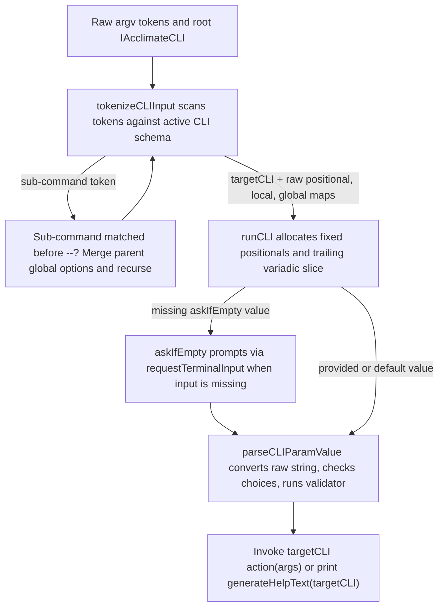
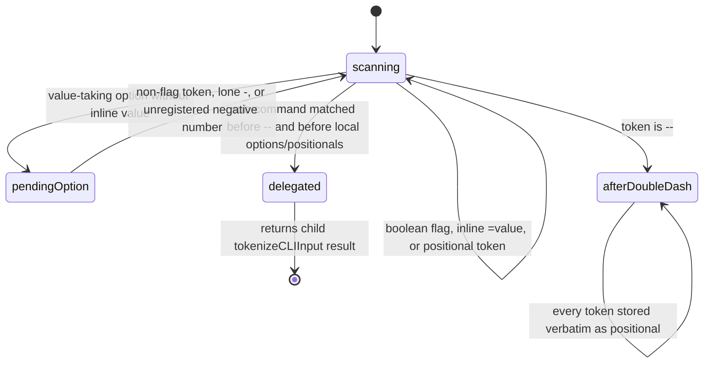

# Repeatable Positional Arguments and Interleaved Option Parsing

<small>

> <table border="0">
> <tr><th colspan="2">Files</th><th colspan="2">Lines</th></tr>
> <tr><td>Changed (total)</td><td>20</td><td>Insertions (+)</td><td>3,433</td></tr>
> <tr><td>Added</td><td>10</td><td>Deletions (-)</td><td>1,353</td></tr>
> <tr><td>Deleted</td><td>1</td><td>Net change</td><td>+2,080</td></tr>
> </table>

</small>

## 1. Purpose

CLI authors building commands such as `avandar-lint coverage [PATH]... [--format stylish|agent|json] [--no-prompt]` could not accept a variable list of positional paths because Acclimate rejected any positional count above its fixed parameter list, and could not place flags before or between positional arguments because `runCLI` split raw `argv` at the first `-` token and joined every subsequent non-flag token into the preceding option's value. Users invoking `coverage --format json src/a.ts src/b.ts` got `format: "json src/a.ts src/b.ts"` and zero positional arguments instead of a list of paths.

This change:

- Adds typed variadic positional parameter definitions, eager variadic-last validation, and structured `CLIError` codes (§4).
- Replaces split-on-first-dash scanning with a schema-aware tokenizer supporting interleaved flags, `=value`, `--`, and pre-command global options<sup>G2</sup> (§5).
- Allocates trailing positional slices, enforces `choices` and numeric validation, and isolates variadic defaults during execution (§6).
- Renders variadic positional arguments<sup>G6</sup> with trailing `...` and `[]` type labels in generated help output (§7).

## 2. Background technical context

```text
src/
├── index.ts                                  (changed)
├── CLIError.ts                               (changed)
├── requestTerminalInput/
│   └── requestTerminalInput.ts
└── AcclimateCLI/
    ├── CLIParam.types.ts                     (new)
    ├── AcclimateCLI.types.ts                 (changed)
    ├── AcclimateCLI.ts                       (changed)
    ├── createCLI/
    │   └── createCLI.ts
    ├── generateHelpText/
    │   └── generateHelpText.ts               (changed)
    └── runCLI/
        ├── runCLI.ts                         (changed)
        ├── tokenizeCLIInput/                 (new)
        │   └── tokenizeCLIInput.ts
        └── parseCLIParamValue/               (new)
            └── parseCLIParamValue.ts
```

<small>

| Unit | What it is |
| --- | --- |
| `src/index.ts` | The package's public barrel export. Re-exports `Acclimate`, `CLIError`, and parameter and builder types for downstream CLIs. |
| `CLIError` | Structured error class thrown on invalid CLI builder configuration, unrecognized or incomplete flags, missing required inputs, and failed value validation. |
| `requestTerminalInput` | Reads interactive answers from `node:readline/promises` when a missing parameter enables `askIfEmpty`. Called by `runCLI`. |
| `CLIParam.types.ts` | Defines scalar and variadic parameter configuration shapes and the `ValueOfParam` type mapper consumed by `AcclimateCLI.types.ts`. |
| `AcclimateCLI.types.ts` | Defines the immutable fluent builder interface `IAcclimateCLI`, its `CLIState` snapshot, and `FullCLIArgValues` inference. |
| `AcclimateCLI` | Implements the immutable builder returned by `createCLI`, validating positional ordering rules inside `addPositionalArg`. |
| `createCLI` | Public factory that seeds `AcclimateCLI` with empty positional, option, global-option, and command collections. |
| `generateHelpText` | Formats a CLI's name, description, positional arguments, options, global options<sup>G2</sup>, and sub-commands into ANSI terminal output. |
| `runCLI` | Entry point that executes a CLI against an `argv` array, coordinating tokenization, prompting, validation, and action dispatch. |
| `tokenizeCLIInput` | Pure functional scanner that resolves sub-commands and splits raw `argv` tokens into positional tokens, local options, and global options<sup>G2</sup>. |
| `parseCLIParamValue` | Pure scalar parser and validator that converts one raw string (or default) and enforces numeric parsing, `choices`, and custom validators. |

</small>

## 3. Shape of the solution

This section gives the end-to-end execution architecture that connects the four strands below. Every `runCLI` invocation now runs a strict three-stage pipeline instead of splitting `argv` blindly before knowing which sub-command will execute:



> *Tokenization descends through sub-commands while scanning `argv`, so option arity (boolean flag versus value-taking option) is always checked against the exact command that owns those flags.*

The four strands depend on each other in order: §4 defines the discriminated parameter types and error codes, §5 uses the CLI's declared option schema to tokenize `argv` and resolve sub-commands, §6 consumes the tokenized output to allocate and validate variadic arrays and options, and §7 reads the same `variadic` flag on `CLIState.positionalArgs` to format help output.

## 4. Variadic positional arguments are enforced at compile time and construction time

This strand establishes the public API contract that both downstream TypeScript callers and the runtime parser depend on: how a caller declares a repeatable positional argument, what type `action(args)` receives, and which positional layouts are rejected immediately.

### 4.1 Discriminated scalar and variadic parameter types infer array values without breaking existing callers

`CLIPositionalParam` in `src/AcclimateCLI/CLIParam.types.ts` is now a discriminated union of `CLIScalarPositionalParam` (`variadic?: false`) and `CLIVariadicPositionalParam` (`variadic: true`). Keeping scalar and variadic shapes separate prevents a scalar positional argument<sup>G4</sup> from accepting an array `defaultValue` and prevents a variadic argument from accepting a bare string, number, or boolean `defaultValue`.

**File: `src/AcclimateCLI/CLIParam.types.ts`**

```typescript {1-8}
export type ValueOfParam<T extends CLIParam | CLIVariadicPositionalParam> =
  T extends CLIVariadicStringParam<string, infer PValue> ? PValue[]
  : T extends CLIVariadicNumberParam<string, infer PValue> ? PValue[]
  : T extends CLIVariadicBooleanParam<string> ? boolean[]
  : T extends CLIStringParam<string, infer PValue> ? PValue
  : T extends CLINumberParam<string, infer PValue> ? PValue
  : T extends CLIBooleanParam<string> ? boolean
  : never;
```

Because `CLIVariadicPositionalParam` constrains `variadic` to literal `true` and `CLIScalarPositionalParam` constrains it to `false | undefined`, TypeScript contextually preserves `variadic: true` inside `addPositionalArg` without requiring a `const` type parameter on `P` (which would over-narrow plain `defaultValue: "us-east-1"` strings into literal types). The variadic branches appear first in `ValueOfParam` so `variadic: true` configs resolve to `PValue[]` while omitted or `variadic: false` configs fall through to the existing scalar branches.

`choices` on both scalar and variadic string/number parameters is widened from `PValue[]` to `readonly PValue[]`. That widening is backwards-compatible with mutable arrays while allowing `choices: ["stylish", "agent", "json"] as const` to narrow the inferred `action(args)` type to `("stylish" | "agent" | "json")[]` or `"stylish" | "agent" | "json"`.

`CLIParamDataType` now includes `string[] | number[] | boolean[]` alongside `CLIParamScalarValue | undefined` so generic action spies and error details accept variadic values. `IAcclimateCLI` retains its exact four generic parameters so existing references to `IAcclimateCLI` and `AnyCLI` compile unchanged.

### 4.2 Eager ordering checks reject any positional argument after a variadic one

**File: `src/AcclimateCLI/AcclimateCLI.ts`**

```typescript {7-16}
    addPositionalArg: <
      PName extends CLIPositionalParamName,
      P extends CLIPositionalParam<PName>,
    >(
      param: P,
    ) => {
      const existingVariadicArg = state.positionalArgs.find((existingParam) => {
        return existingParam.variadic === true;
      });
      if (existingVariadicArg) {
        throw CLIError.invalidPositionalArgConfig({
          cliName,
          positionalArgName: param.name,
          message: `Variadic positional argument "${existingVariadicArg.name}" must be the last positional argument`,
        });
      }
```

The highlighted guard runs before the existing required-after-optional check inside `addPositionalArg`. Checking for a prior variadic argument first ensures that adding a required argument after an optional variadic argument reports the root cause (nothing may follow a variadic argument) rather than only flagging required-after-optional. Together, the two guards establish the invariant that `runCLI` relies on in §6: at most one variadic positional argument<sup>G6</sup> exists, and when present it always occupies the final index of `state.positionalArgs`.

### 4.3 `CLIError` exposes `code` and adds `missing_option_value`

`src/CLIError.ts` adds the `missing_option_value` error variant and `CLIError.missingOptionValue` factory, and stores `this.code = options.code` on a `readonly code: CLIErrorCode` property. `src/index.ts` exports `CLIError` and `CLIErrorCode` so consumers and tests can distinguish failure categories programmatically instead of matching formatted message text.

## 5. Schema-aware tokenization separates flags, sub-commands, and positional arguments without greedy value consumption

This strand addresses the core parsing limitation in v0.4.0. Rather than splitting `argv` at the first `-` token and assuming every non-flag token after an option belongs to that option, `tokenizeCLIInput` uses schema-aware tokenization<sup>G5</sup> to scan tokens left to right against the active CLI's declared options, aliases, global options<sup>G2</sup>, and sub-commands.

The structural fact to hold in mind is that tokenization and sub-command dispatch happen in one recursive pass, not as two separate passes. Option arity (whether `-v` consumes zero tokens or `--format` consumes one) depends on the command that owns the flag, and global options<sup>G2</sup> can appear before the sub-command name (`avandar-lint -v coverage src/a.ts`), so `tokenizeCLIInput` must resolve parent global options first, descend as soon as a sub-command matches, and then scan the remaining tokens against the child command's option table.



> *`tokenizeCLIInput` moves a `TokenScanState` across four modes; reaching `pendingOption` at end of input, before `--`, or before another flag throws `CLIError` with code `missing_option_value`.*

### 5.1 Ordered token-scanning steps inside `tokenizeCLIInput`

#### Step 1. `_stepToken` routes by current scan state

**File: `src/AcclimateCLI/runCLI/tokenizeCLIInput/tokenizeCLIInput.ts`**

```typescript {8-24}
function _stepToken(options: {
  cli: AnyCLI;
  state: Readonly<TokenScanState>;
  token: string;
  remainingTokens: readonly string[];
}): TokenScanState {
  ...
  if (state.delegatedResult) {
    return state;
  }
  if (state.pendingOption) {
    return _consumePendingOptionToken({ cli, state, token });
  }
  if (state.isAfterDoubleDash) {
    return {
      ...state,
      rawPositionalArgs: [...state.rawPositionalArgs, token],
    };
  }
  if (token === "--") {
    return { ...state, isAfterDoubleDash: true };
  }
  if (_isOptionLikeToken(token)) {
    return _consumeFlagToken({ cli, state, token });
  }
  return _consumePositionalOrCommandToken({ ... });
}
```

Checking for a pending option<sup>G3</sup> before checking the end-of-options separator<sup>G1</sup> (`--`) ensures that `--format -- src/a.ts` fails immediately with `missing_option_value` instead of treating `--` as a silent separator that leaves `--format` unset. Checking `state.isAfterDoubleDash` before matching `--` ensures that a second `--` after the first end-of-options separator (as in `lint -- --`) is kept literally as a positional argument.

#### Step 2. `_consumePendingOptionToken` accepts exactly one value token

When a string or number option is seen without `=`, the scanner enters a pending option<sup>G3</sup> state, and `_consumePendingOptionToken` inspects the next token and rejects `--`, any registered flag or alias, and any unregistered option-like token that does not match `NEGATIVE_NUMBER_PATTERN` (`/^-(\d+(\.\d+)?|\.\d+)$/`). A lone `-` (Unix stdin/stdout marker) and unregistered negative numbers (such as `-5` in `--offset -5` or `-1` in `--age -1`) are accepted as the option's single value and return the scanner to `scanning`. If input ends while a pending option is still active, `tokenizeCLIInput` throws `CLIError.missingOptionValue`.

#### Step 3. `_consumeFlagToken` classifies flags, inline `=value` assignments, and negative numeric positionals

`_splitInlineOptionToken` splits on the first `=` only so values containing `=` (such as `-d=NODE_ENV=test`) stay intact and `--empty=` records `""`. `_findOptionEntry` maps aliases via `cli.state.aliases` and checks `globalOptionArgs` before `optionArgs` (matching `runCLI`'s spread precedence).

- If no declared option matches and there is no `=`, an unregistered negative numeric token (such as `-3.5`) is appended to `rawPositionalArgs` so numeric positional arguments accept negative numbers; any other unknown flag throws `CLIError.unknownOption`.
- If an inline `=` value is present, it is recorded immediately for both boolean and value-taking options with zero lookahead.
- If no inline value is present, a `boolean` option records `""` (which `parseCLIParamValue` parses as `true`) and consumes zero following tokens, while a `string` or `number` option sets `pendingOption`.

This step deliberately does not split multi-character single-dash tokens into bundled short flags (`-vf`) because `CLIOptionAlias` permits multi-character single-dash aliases (`-${string}`).

#### Step 4. `_consumePositionalOrCommandToken` descends into sub-commands with inherited global options

Sub-command dispatch triggers only when three conditions all hold: `!state.isAfterDoubleDash`, `state.rawPositionalArgs.length === 0`, and `Object.keys(state.rawOptionArgs).length === 0`. Requiring an empty `rawOptionArgs` prevents a root-only local option from silently dropping when followed by a token that happens to share a sub-command's name (`root --root-only run` stays on `root`), while allowing root global options<sup>G2</sup> (`avandar-lint -v coverage src/a.ts`) to precede the sub-command.

When a sub-command matches, `_mergeParentGlobalOptions` copies the parent's `globalOptionArgs` (and aliases) onto the matched child CLI via `addGlobalOption`, then recursively invokes `tokenizeCLIInput` on `remainingTokens` with `inheritedGlobalOptionArgs: state.rawGlobalOptionArgs`. Any global option<sup>G2</sup> repeated inside the sub-command overwrites the inherited value because last occurrence wins.

### 5.2 Worked trace across two boundary inputs

| Input tokens | Trace of `TokenScanState` transitions | Output |
| --- | --- | --- |
| `["-v", "coverage", "src/a.ts", "--format", "json", "--", "-x"]` | 1. `-v` matches root global boolean `--verbose` -> records `rawGlobalOptionArgs["--verbose"] = ""`. 2. `coverage` matches root command (`rawPositionalArgs` and `rawOptionArgs` are empty) -> merges `--verbose` into `coverage` and recurses on remaining 5 tokens. 3. `src/a.ts` -> `rawPositionalArgs = ["src/a.ts"]`. 4. `--format` (string) -> sets `pendingOption = --format`. 5. `json` -> records `rawOptionArgs["--format"] = "json"`, clears `pendingOption`. 6. `--` -> sets `isAfterDoubleDash = true`. 7. `-x` -> appended verbatim to `rawPositionalArgs`. | `targetCLI: coverage`, `rawPositionalArgs: ["src/a.ts", "-x"]`, `rawOptionArgs: { "--format": "json" }`, `rawGlobalOptionArgs: { "--verbose": "" }` |
| `["--config", "coverage", "coverage", "src/a.ts"]` | 1. `--config` (root global string) -> sets `pendingOption = --config`. 2. First `coverage` is consumed by `pendingOption` (`rawGlobalOptionArgs["--config"] = "coverage"`), not matched as a sub-command. 3. Second `coverage` arrives while `pendingOption` is cleared -> matches sub-command `coverage` and recurses on `["src/a.ts"]`. | `targetCLI: coverage`, `rawPositionalArgs: ["src/a.ts"]`, `rawGlobalOptionArgs: { "--config": "coverage" }` |

### 5.3 Intentional compatibility boundary on option value consumption

In v0.4.0, options greedily joined all following non-flag tokens with spaces (`["--tags", "one", "two", "three"]` produced `tags: "one two three"`). That behavior cannot coexist with positional arguments appearing after flags, because `--format json src/a.ts src/b.ts` would have no boundary between the option value and the positional paths. Value-taking options now consume exactly one token; callers needing spaces inside one value pass a single quoted token (`"--tags", "one two three"`), and stray unflagged tokens on a CLI with no positional arguments throw `CLIError` (`too_many_positional_args`).

## 6. Execution allocates trailing positional slices, validates every element, and isolates default arrays

This strand explains how `runCLI` and `parseCLIParamValue` turn the tokenizer's raw string maps into validated, typed runtime values for `action(args)`.

### 6.1 `parseCLIParamValue` enforces numeric validity, `choices`, and custom validators uniformly

`src/AcclimateCLI/runCLI/parseCLIParamValue/parseCLIParamValue.ts` centralizes scalar conversion for options, fixed positional arguments, and every element of a variadic positional argument<sup>G6</sup>:

1. Custom `parser` runs when supplied; otherwise `"string"` returns the raw string, `"number"` runs `Number.parseInt(inputValue, 10)` and throws `CLIError.invalidCLIParamValue` when the result is `NaN`, and `"boolean"` preserves Acclimate's contract (`inputValue !== "false"`).
2. If `choices` is configured and non-empty, any parsed value (or default value) not matching an entry throws `CLIError.invalidCLIParamValue` listing the allowed choices.
3. Custom `validator` runs last, throwing `CLIError.invalidCLIParamValue` with the returned string message (or default message on `false`).

### 6.2 Trailing positional allocation and zero-input behavior for variadic arguments

In `src/AcclimateCLI/runCLI/runCLI.ts`, `_parsePositionalArgs` skips the `too_many_positional_args` guard whenever any positional parameter has `variadic: true`, allocates `rawPositionalArgs[idx]` to each leading scalar parameter, and slices `rawPositionalArgs.slice(idx)` for the trailing variadic parameter.

When the variadic slice is empty, `_parseVariadicPositionalArg` handles four cases in order:

| Condition | Result |
| --- | --- |
| `askIfEmpty` set, user enters non-empty answer | Single-element array `[parsedAnswer]` validated through `parseCLIParamValue` |
| `askIfEmpty` set, user submits blank and `defaultValue` is configured | Validated fresh mutable copy of `defaultValue` (even when `required: true`) |
| `required: true` with no value supplied (non-interactive or blank without defaults) | Throws `CLIError` (`missing_required_positional_arg`), ignoring `defaultValue` when non-interactive |
| `required: false` with no value supplied | Validated fresh mutable copy of `defaultValue` when set, otherwise `[]` |

Two subtle guarantees hold here:

- **Default array isolation:** `_parseVariadicValues` maps `defaultValue` through `parseCLIParamValue` and filters into a brand-new array on every execution. Mutating `args.paths` inside an action never mutates `argConfig.defaultValue` across runs.
- **No string joining on `askIfEmpty` variadic prompts:** `_promptVariadicPositionalArg` passes `defaultValue: undefined` and `required: argConfig.required && !hasDefaults` to `requestTerminalInput`. Joining `["src", "tests"]` into `"src, tests"` for `requestTerminalInput` would cause a blank Enter press to return one corrupted string `"src, tests"` instead of the two-element array `["src", "tests"]`; passing `undefined` lets a blank Enter cleanly fall back to the validated `defaultValue` array.

## 7. Help text marks variadic positional arguments with ellipsis and array type labels

This strand covers the sole user-visible output change: how `generateHelpText` displays variadic positional arguments<sup>G6</sup> while leaving scalar positional arguments<sup>G4</sup>, options, global options<sup>G2</sup>, and sub-commands byte-for-byte unchanged.

Because `@avandar/acclimate` is a headless Node.js CLI framework with no GUI, the changed terminal output is shown directly as rendered text rather than a browser screenshot:

```text
lint
  Lint workspace files

Positional Arguments
  target (string) required - Primary target
  paths... (string[]) optional - Additional paths [default: ["."]]
```

In `src/AcclimateCLI/generateHelpText/generateHelpText.ts`, `_formatParamLine` appends `...` to `param.name` and `[]` to `param.type` only when `param.variadic === true`. This change also fixes four pre-existing ESLint and TypeScript strict-mode violations in `generateHelpText.ts` (an unused `idx` parameter, two concise arrow bodies, and a non-simple `T[]` array annotation) so `npm run type` and `npm run lint` pass with zero errors across the repository.

## 8. Decisions

- **Extend `addPositionalArg` with a discriminated `variadic?: boolean` field rather than adding a separate `addVariadicPositionalArg` builder method.** Acclimate configures every parameter through declarative config objects, and TypeScript contextually discriminates `variadic: true` versus `variadic?: false` so scalar and variadic `defaultValue` types stay strictly separated without duplicating builder methods. Reversal condition: introduce a separate method only if variadic arguments later accumulate configuration fields (such as custom delimiters or min/max arity bounds) that clutter scalar positional definitions.
- **Replace greedy multi-token option joining with single-token option consumption and reject unknown flags before `--`.** Greedy joining makes flags before positional arguments ambiguous (for example `--format json src/a.ts`), and silently ignoring unknown flags causes typos to be misread as positional arguments. Reversal condition: add explicit opt-in multi-value options (`variadic: true` on `addOption`) in a separate change if a CLI genuinely requires repeatable flag values.
- **Accept unregistered negative numeric tokens as option values or positional arguments while giving registered aliases precedence.** This allows `--age -1` and variadic numeric lists (`sum 10 -5 3`) to work naturally without requiring `--`, while still honoring an explicit alias like `-1`. Reversal condition: revisit only if single-dash flag clustering is ever introduced.
- **Enforce variadic-must-be-last at builder runtime rather than adding a fifth generic parameter to `IAcclimateCLI`.** Runtime enforcement in `addPositionalArg` matches the existing required-before-optional rule and preserves 100% compatibility for callers referencing `IAcclimateCLI`'s four type parameters. Reversal condition: add compile-time tuple tracking only if breaking the `IAcclimateCLI` type arity is acceptable in a major release.
- **Split the monolithic `runCLI.test.ts` (over 1,000 lines with the new variadic tests) into focused suites under `src/AcclimateCLI/runCLI/__tests__/`.** Grouping `runCLI.positional.test.ts`, `runCLI.options.test.ts`, `runCLI.commands.test.ts`, and `runCLI.variadic.test.ts` beside shared `runCLI.testHelpers.ts` keeps every TypeScript file under 400 lines while retaining all existing test cases. Reversal condition: none; the split has no runtime impact.

## 9. Deliberately not handled

- **Short-flag bundling (for example `-vf` for `-v -f`):** Not implemented because `CLIOptionAlias` permits multi-character single-dash aliases (`-${string}`), which would collide with per-character splitting.
- **Repeatable options (`--include a --include b` collecting an array):** Out of scope for this change; repeated options continue to follow last-occurrence-wins semantics.
- **TTY-aware prompt guard in `requestTerminalInput`:** Interactive prompting behavior when stdin is not a TTY is left untouched for a dedicated follow-up PR.
- **Usage synopsis line in `generateHelpText`:** Help formatting keeps its existing section layout and adds only variadic `...` and `[]` markers on positional argument entries.

<div style="page-break-before: always"></div>

## Appendix A. Manual testing

<small>

1. Install dependencies from the repository root if `node_modules/` is not yet populated:

   ```sh
   npm install
   ```

2. Run the targeted test suites covering builder ordering, type inference, tokenization, value parsing, CLI execution, and help formatting:

   ```sh
   npx vitest run src/AcclimateCLI/createCLI/createCLI.test.ts src/AcclimateCLI/runCLI/tokenizeCLIInput/tokenizeCLIInput.test.ts src/AcclimateCLI/runCLI/parseCLIParamValue/parseCLIParamValue.test.ts src/AcclimateCLI/runCLI/__tests__/ src/AcclimateCLI/generateHelpText/generateHelpText.test.ts
   ```

   Pass condition: all 8 targeted test files pass with 0 failures (85 tests).

3. Run full repository verification (TypeScript type check, ESLint, full Vitest suite, and `tsup` ESM/CJS/DTS bundle):

   ```sh
   npm run type && npm run lint && npm test && npm run build
   ```

   Pass condition: `tsc --noEmit` exits 0, `eslint .` exits 0 with 0 warnings/errors, all 10 test files (97 tests) pass, and `dist/index.js`, `dist/index.cjs`, `dist/index.d.ts`, and `dist/index.d.cts` build cleanly.

4. Verify interleaved flags, global options<sup>G2</sup> before sub-commands, variadic positional collection, and `--` end-of-options handling directly with `tsx`:

   ```sh
   npx tsx -e '
     import { Acclimate } from "./src";
     const cov = Acclimate.createCLI("coverage")
       .addPositionalArg({ name: "paths", type: "string", required: false, variadic: true })
       .addOption({ name: "--format", aliases: ["-f"] as const, type: "string", required: false, choices: ["stylish", "agent", "json"] as const, defaultValue: "stylish" })
       .addOption({ name: "--no-prompt", type: "boolean", required: false, defaultValue: false })
       .action((args) => { console.log(JSON.stringify(args)); });
     const root = Acclimate.createCLI("avandar-lint")
       .addGlobalOption({ name: "--verbose", aliases: ["-v"] as const, type: "boolean", required: false, defaultValue: false })
       .addCommand("coverage", cov);
     Acclimate.run(root);
   ' -- avandar-lint -v coverage src/a.ts --format json src/b.ts --no-prompt -- -weird.ts
   ```

   - **Before this change:** `-v` triggered option parsing at index 0, preventing `coverage` from matching as a sub-command, and `--format` greedily joined trailing paths into one string.
   - **Now:** stdout prints:

   > `{"paths":["src/a.ts","src/b.ts","-weird.ts"],"format":"json","noPrompt":true,"verbose":true}`

</small>

<div style="page-break-before: always"></div>

## Appendix B. Glossary

<small>

| Term | Meaning |
| --- | --- |
| **G1** End-of-options separator | The literal `--` token in `argv` that ends flag and sub-command parsing so every subsequent token is treated verbatim as a positional argument. |
| **G2** Global option | A named CLI option registered with `addGlobalOption` on a parent CLI that is automatically inherited by every nested sub-command and may be passed before or after the sub-command name. |
| **G3** Pending option | The tokenizer state entered after reading a value-taking option (`string` or `number`) without an inline `=value`, in which the immediately following token must supply that option's single raw value. |
| **G4** Scalar positional argument | A single-value positional parameter (`variadic` omitted or `false`) that consumes at most one positional token and passes a `string`, `number`, or `boolean` to `action(args)`. |
| **G5** Schema-aware tokenization | Scanning raw `argv` tokens against the active CLI's declared options, aliases, and sub-commands so boolean flags consume zero tokens and value-taking options consume exactly one token. |
| **G6** Variadic positional argument | A repeatable trailing positional parameter configured with `variadic: true` that collects zero-or-more (`required: false`) or one-or-more (`required: true`) remaining positional tokens into a typed array. |

</small>
