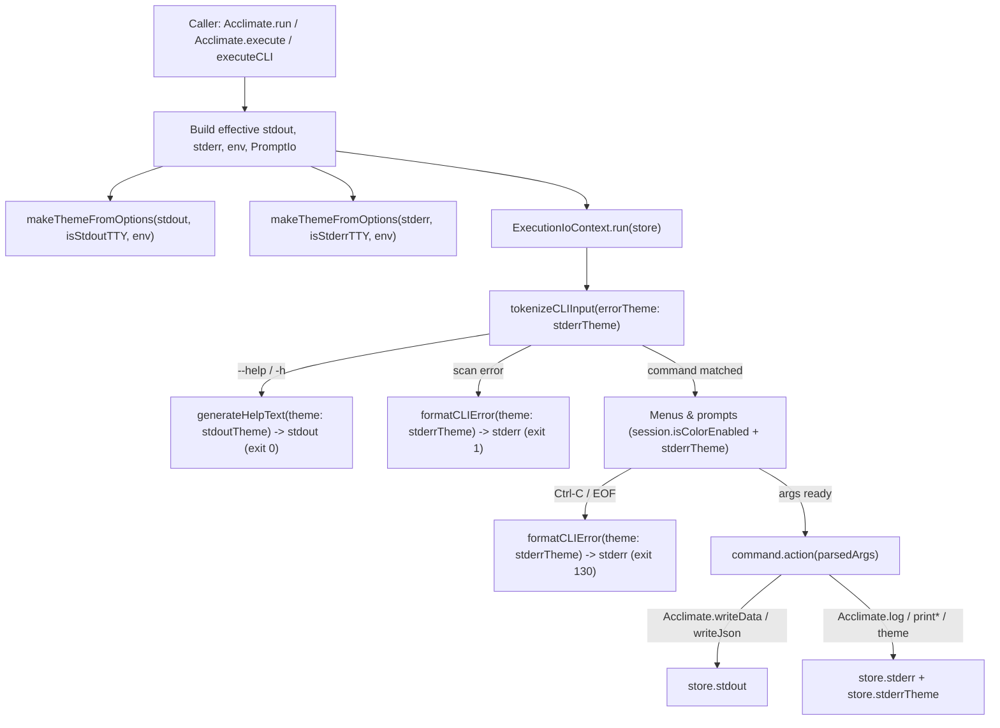

# Dark-Terminal Semantic Theming and Injectable Execution IO

<small>

> <table border="0">
> <tr><th colspan="2">Files</th><th colspan="2">Lines</th></tr>
> <tr><td>Changed (total)</td><td>50</td><td>Insertions (+)</td><td>2,990</td></tr>
> <tr><td>Added</td><td>16</td><td>Deletions (-)</td><td>749</td></tr>
> <tr><td>Deleted</td><td>1</td><td>Net change</td><td>+2,241</td></tr>
> </table>

</small>

## 1. Purpose

CLIs built with `@avandar/acclimate` emitted raw ANSI color tokens unconditionally during help rendering and error usage formatting, leaking escape sequences into piped `stdout`, `stderr`, `NO_COLOR` runs, and `TERM=dumb` shells. Styling decisions were scattered across raw color strings (`|red|`, `|yellow|`, `|bright_cyan|`, `|gray|`, `|dim|`) that mixed low-contrast dark foreground codes (`31`, `33`) with bright codes and offered no shared semantic palette or status helpers. Meanwhile, `Acclimate.run(cli)` read `process.argv.slice(2)` directly, discarded the execution promise (`void executeCLI(...)`), always mutated `process.exitCode`, and accepted no injectable arguments, streams, TTY flags, or prompt handles for in-process testing or embedding.

This change:

- Centralizes ten dark-terminal high-contrast semantic roles<sup>G5</sup> with automatic plain mode<sup>G3</sup> for redirected streams, non-empty `NO_COLOR`, and `TERM=dumb` (§4).
- Routes help text, error formatting, choice menus, and interactive prompts through per-stream semantic themes so piped help and error usage emit zero ANSI escapes (§5).
- Upgrades `Acclimate.run` to return `Promise<number>` with injectable execution IO, adds `Acclimate.execute`, and scopes injected streams across async actions (§6).
- Splits the `Acclimate` facade into a directory module exposing semantic theme controls and `stderr` status helpers (`printSuccess`, `printInfo`, `printWarn`, `printError`) (§7).

## 2. Background technical context

```text
src/
├── index.ts                                       (changed)
├── Acclimate/                                     (replaces src/Acclimate.ts)
│   ├── Acclimate.types.ts                         (new)
│   └── Acclimate.ts                               (new)
├── theme/                                         (new)
│   ├── theme.constants.ts
│   ├── theme.types.ts
│   ├── stripAnsi/
│   │   └── stripAnsi.ts
│   ├── createTheme/
│   │   └── createTheme.ts
│   └── makeThemeFromOptions/
│       └── makeThemeFromOptions.ts
├── generateTerminalMessage/
│   └── generateTerminalMessage.ts                 (changed)
├── terminalSession/
│   ├── terminalSession.types.ts                   (changed)
│   ├── isColorEnabledForStream/
│   │   └── isColorEnabledForStream.ts             (changed)
│   └── makeTerminalSessionFromPromptIo/           (new)
│       └── makeTerminalSessionFromPromptIo.ts
├── requestChoiceMenu/
│   ├── requestChoiceMenu.types.ts                 (changed)
│   ├── renderChoiceMenu/
│   │   └── renderChoiceMenu.ts                    (changed)
│   ├── runPlainChoiceMenu.ts                      (changed)
│   └── requestChoiceMenu.ts                       (changed)
├── requestTerminalInput/
│   └── requestTerminalInput.ts                    (changed)
└── AcclimateCLI/
    ├── ExecutionIoContext/                        (new)
    │   └── ExecutionIoContext.ts
    ├── executeCLI/
    │   └── executeCLI.ts                          (changed)
    ├── formatCLIError/
    │   └── formatCLIError.ts                      (changed)
    ├── generateHelpText/
    │   ├── helpSectionHelpers.ts                  (new)
    │   └── generateHelpText.ts                    (changed)
    └── runCLI/
        ├── attachCLIErrorHelpContext.ts           (changed)
        ├── parseTargetCLIArgs.ts                  (changed)
        ├── promptCLIParam/
        │   └── promptCLIParam.ts                  (changed)
        ├── runCLI.ts                              (changed)
        └── tokenizeCLIInput/
            └── tokenizeCLIInput.ts                (changed)
```

<small>

| Unit                                 | What it is                                                                                                                                                                                                                   |
| ------------------------------------ | ---------------------------------------------------------------------------------------------------------------------------------------------------------------------------------------------------------------------------- |
| `src/index.ts`                       | Public package entry point. Exports `createTheme`, `stripAnsi`, palette constants, `Acclimate`, `executeCLI`, `generateHelpText`, prompt helpers, and their public types.                                                    |
| `src/Acclimate/Acclimate.ts`         | Public facade implementing `run`, `execute`, `theme`, `createTheme`, `setTheme`, `resetTheme`, `log`, `printSuccess`, `printInfo`, `printWarn`, `printError`, `writeData`, `writeJson`, `requestInput`, and `requestChoice`. |
| `src/Acclimate/Acclimate.types.ts`   | Option and facade type declarations (`AcclimateRunOptions`, `AcclimateLogOptions`, `AcclimateStatusPrintOptions`, `AcclimateErrorPrintOptions`, `AcclimateFacade`).                                                          |
| `theme.constants.ts`                 | Single source of truth for `ANSI_RESET_CODE`, `ANSI_STYLE_CODES`, `SEMANTIC_THEME_ROLES`, and `DEFAULT_DARK_THEME_PALETTE`.                                                                                                  |
| `theme.types.ts`                     | Types derived from `theme.constants.ts` covering `SemanticThemeRole`, `AnsiStyleToken`, `SemanticThemePalette`, `SemanticTheme`, and `ThemeInput`.                                                                           |
| `stripAnsi.ts`                       | Removes ANSI CSI color and cursor-control sequences while preserving text, newlines, and emoji.                                                                                                                              |
| `createTheme.ts`                     | Pure builder constructing a semantic theme whose role methods emit bright-half ANSI sequences only when color is enabled for the target stream and environment.                                                              |
| `makeThemeFromOptions.ts`            | Normalizes a caller's optional `ThemeInput`, explicit `color`, `stream`, `isTTY`, `env`, and `fallbackPalette` into one concrete `SemanticTheme`.                                                                            |
| `generateTerminalMessage.ts`         | Interpolates `$varName$` tokens and applies both raw `\|<COLOR>\|` and semantic `\|<ROLE>\|` tokens, or strips known tokens in plain mode<sup>G3</sup>.                                                                      |
| `isColorEnabledForStream.ts`         | Single stream color gate returning `true` only when `isTTY` (explicit override or `stream.isTTY`) is `true`, `NO_COLOR` is unset or empty, and `TERM` is not `"dumb"`.                                                       |
| `makeTerminalSessionFromPromptIo.ts` | Adapts a lightweight `PromptIo` pair into a `TerminalSession`, deriving color and raw-mode capabilities from the output stream and environment.                                                                              |
| `ExecutionIoContext.ts`              | Node `AsyncLocalStorage` container scoping injected streams, environment, per-stream themes, and prompt IO<sup>G4</sup> across async command actions.                                                                        |
| `helpSectionHelpers.ts`              | Semantic section formatters (`formatHelpUsageSection`, `formatHelpParamSection`, `formatHelpExamplesSection`, `formatHelpCommandSection`, `getBuiltinHelpOption`) extracted from `generateHelpText`.                         |
| `generateHelpText.ts`                | Renders command help via `SemanticTheme`, accepting `commandPath`, `color`, `theme`, `stream`, `isTTY`, and `env`.                                                                                                           |
| `formatCLIError.ts`                  | Formats `CLIError` headlines (`error`), indented `⚠️` recovery hints (`warning`), and command usage sanitized via `stripAnsi` when plain mode<sup>G3</sup> is active.                                                        |
| `runCLI.ts`                          | Resolves `stdout` and `stderr` TTY overrides, builds independent per-stream themes, enters `ExecutionIoContext`, and runs tokenization, prompting, help output, and `.action()`.                                             |
| `executeCLI.ts`                      | Process and embedded execution boundary accepting `args` or `input`, TTY overrides, `promptIo`, and `theme`, catching errors to `stderr` and returning `0`, `1`, or `130`.                                                   |

</small>

## 3. Shape of the solution

Two independent concerns connect at `runCLI` and `executeCLI`: the semantic theme layer (`src/theme/`) decides which ANSI sequences (if any) wrap each semantic role<sup>G5</sup> for a specific output stream, and the execution IO boundary (`ExecutionIoContext`, `makeTerminalSessionFromPromptIo`, `runCLI`, `executeCLI`, `Acclimate`) injects arguments, streams, TTY flags, and prompt handles without reading process globals inside core modules.



<small>

> **Figure 1.** Data flow through the injectable execution boundary. `stdout` and `stderr` each receive their own `SemanticTheme` computed from their respective TTY flags and `env`, so redirecting `stdout` into a pipe disables ANSI escapes on `stdout` help without affecting an interactive `stderr` terminal, and vice versa.

</small>

## 4. Dark-terminal semantic theme layer and plain-mode gate

### 4.1 High-contrast bright-half default palette and `createTheme`

Terminals do not reliably expose whether they use a light or dark background, and standard ANSI foreground codes `30`-`37` (such as dark red `\x1b[31m` and dark blue `\x1b[34m`) have poor contrast on black terminal themes. `DEFAULT_DARK_THEME_PALETTE` in `src/theme/theme.constants.ts` maps all ten semantic roles<sup>G5</sup> exclusively to the bright-half ANSI palette<sup>G1</sup> (`90`-`97`, plus bold `\x1b[1m` on `selected`):

| Role       | Default ANSI prefix                         | Usage                                                                |
| ---------- | ------------------------------------------- | -------------------------------------------------------------------- |
| `heading`  | `\x1b[93m` (`bright_yellow`)                | Help section titles (`Usage`, `Options`, `Commands`, `Examples`)     |
| `accent`   | `\x1b[96m` (`bright_cyan`)                  | CLI and sub-command names                                            |
| `value`    | `\x1b[97m` (`bright_white`)                 | Option/argument names, worked examples, command bullets              |
| `muted`    | `\x1b[90m` (`bright_black`)                 | Descriptions, `(optional)`, `(default)`, `[choices: ...]`, key hints |
| `success`  | `\x1b[92m` (`bright_green`)                 | `✅` status banners and `✔` menu confirmations                       |
| `warning`  | `\x1b[93m` (`bright_yellow`)                | `⚠️` warnings, indented recovery hints, `✖ Cancelled`                |
| `error`    | `\x1b[91m` (`bright_red`)                   | `❌` failure lines, `required` markers, inline validation retries    |
| `info`     | `\x1b[94m` (`bright_blue`)                  | `ℹ️` progress and status lines                                       |
| `prompt`   | `\x1b[96m` (`bright_cyan`)                  | Interactive prompt questions                                         |
| `selected` | `\x1b[1m\x1b[92m` (`bold` + `bright_green`) | Highlighted choice menu item beside the `❯` cursor                   |

`createTheme` (`src/theme/createTheme/createTheme.ts`) converts each palette override from either a named token (`"bright_magenta"`), an ordered token array (`["bold", "bright_cyan"]`), or a raw ANSI SGR sequence (`"\x1b[38;5;117m"`), falling back to `DEFAULT_DARK_THEME_PALETTE` for every omitted role. When `isColorEnabled` is `false`, `style(role, text)` returns `text` unchanged; when `text` is `""`, it also returns `""` so empty segments never emit stray `\x1b[0m` reset sequences.

### 4.2 Precedence across `isColorEnabledForStream` and `makeThemeFromOptions`

Every color decision flows through `isColorEnabledForStream`:

```ts
export function isColorEnabledForStream(options: {
  stream?: Readonly<TerminalOutputStream>;
  isTTY?: boolean;
  env?: Readonly<Record<string, string | undefined>>;
}): boolean {
  const env = options.env ?? process.env;
  const isNoColorSet = env.NO_COLOR !== undefined && env.NO_COLOR !== "";
  const isDumbTerm = env.TERM === "dumb";
  const isTty = options.isTTY ?? options.stream?.isTTY === true;
  return isTty && !isNoColorSet && !isDumbTerm;
}
```

An explicit `isTTY` override replaces `stream.isTTY` without mutating the stream object, while non-empty `NO_COLOR` and `TERM === "dumb"` always force plain mode<sup>G3</sup> even when `isTTY` is `true`. Empty `NO_COLOR=""` does not disable color, matching the `no-color.org` specification.

`makeThemeFromOptions` resolves caller inputs in strict precedence order:

1. If `options.color` is explicitly `true` or `false`, it wins.
2. Otherwise, if any of `stream`, `isTTY`, or `env` is supplied, `isColorEnabledForStream` computes the color flag for that stream and environment.
3. Otherwise, if a constructed `SemanticTheme` was passed, its own `isColorEnabled` is kept; if palette overrides or nothing were passed, `options.defaultColor` applies (for example `true` on direct `generateHelpText(cli)` unit calls, or stream-detected via `createTheme()`).

**Worked example:** A test constructs `const custom = createTheme({ palette: { accent: "bright_magenta" } })` inside Vitest (where `process.stderr.isTTY` is `undefined`, so `custom.isColorEnabled` is `false`), and passes `theme: custom` to `Acclimate.run(cli, { args: ["--help"], stdout, isStdoutTTY: true, env: {} })`. Because `runCLI` passes `{ theme: custom, stream: effectiveStdout, env }` into `makeThemeFromOptions`, step 2 detects `isStdoutTTY: true` with empty `env` and calls `custom.withColor(true)`. Help output renders `\x1b[95m` on the TTY stream, while the same `custom` theme passed with `env: { NO_COLOR: "1" }` calls `custom.withColor(false)` and emits zero escapes.

### 4.3 Semantic role tokens in `generateTerminalMessage`

`generateTerminalMessage` shares `ANSI_STYLE_CODES` and `SEMANTIC_THEME_ROLES` from `theme.constants.ts`. Templates can mix existing raw tokens (`|bold|`, `|red|`) with semantic role<sup>G5</sup> tokens (`|heading|`, `|prompt|`, `|error|`, `|selected|`). Semantic role lookups read from the active `SemanticTheme.palette`, and plain mode<sup>G3</sup> strips both raw and semantic tokens while leaving unrecognized tokens (such as `|nope|`) unchanged.

## 5. Consistent semantic styling across help, errors, menus, and prompts

### 5.1 Plain-mode leak in piped help and error usage

#### The Problem

Before this change, `generateHelpText` always called `generateTerminalMessage` with `color: true`, and `attachCLIErrorHelpContext` called `generateHelpText` without passing stream or environment state. Piping `cli --help | cat` emitted raw `\x1b[96m` and `\x1b[93m` escapes on `stdout`, and running `cli --bogus 2> err.log` with `NO_COLOR=1` still embedded ANSI sequences inside the attached usage block on `stderr`.

#### The Solution

`generateHelpText` now delegates section rendering to `helpSectionHelpers.ts` using `SemanticTheme` methods (`accent`, `heading`, `value`, `muted`, `error`) and removes all hardcoded `|...|` color literals. `runCLI` passes `stdoutTheme` when printing `-h`/`--help` or bare unattended usage to `stdout`, and passes `stderrTheme` into `tokenizeCLIInput` and `attachCLIErrorHelpContext` so attached `error.usage` matches `stderr`'s color mode. As defense in depth, `formatCLIError` renders the headline with `theme.error`, renders the indented recovery hint with `theme.warning`, and passes `error.usage` through `stripAnsi` whenever `theme.isColorEnabled` is `false`.

### 5.2 Choice menus and interactive prompts

`renderChoiceMenu`, `runPlainChoiceMenu`, `requestChoiceMenu`, `requestTerminalInput`, and `promptCLIParam` now share `SemanticTheme`:

- `renderChoiceMenu` styles the `?` heading with `theme.prompt`, key hints and `(default)`/descriptions with `theme.muted`, and the active `❯` row with `theme.selected`.
- `requestChoiceMenu` syncs any caller-supplied `theme` to `session.isColorEnabled`, formats cancellations with `theme.warning("✖ Cancelled")`, and formats confirmations with `theme.success("✔")` and `theme.prompt(message)`.
- `requestTerminalInput` formats optional/default hints with `theme.muted` and inline validation errors with `theme.error`.
- `promptCLIParam` passes `|prompt|${baseMessage}|reset|` alongside `theme`, allowing `requestTerminalInput` to strip the token cleanly when converting the message into a choice-menu heading while styling line prompts through `theme.prompt`.

## 6. Injectable execution IO, `PromptIo`, and returned exit codes

### 6.1 `PromptIo` and non-mutating TTY overrides

Tests and embedded callers that do not need to construct a full `TerminalSession` can pass `promptIo: { input, output, isColorEnabled?, isRawModeSupported?, close? }` to `Acclimate.run`, `Acclimate.execute`, `executeCLI`, `runCLI`, `requestChoiceMenu`, or `requestTerminalInput`. `makeTerminalSessionFromPromptIo` derives `isColorEnabled` via `isColorEnabledForStream({ stream: promptIo.output, env })` and disables raw mode whenever `env.TERM === "dumb"` or `input.setRawMode` is absent.

When `isStdoutTTY` or `isStderrTTY` is passed to `runCLI` or `executeCLI`, `_withTtyOverride` wraps the target stream in a forwarding `{ write, isTTY }` adapter rather than mutating the caller's stream (protecting shared objects such as `process.stdout` and `process.stderr`). Both `isColorEnabledForStream` and `openTerminalSession` receive the wrapped streams, keeping color checks and attached-TTY checks consistent.

### 6.2 Async-scoped execution context via `AsyncLocalStorage`

`runCLI` wraps tokenization, help rendering, prompting, and `await matchedState.action(parsedArgs)` inside an execution IO context<sup>G2</sup> via `ExecutionIoContext.run(store, ...)`. The store carries `stdin`, `stdout`, `stderr`, `env`, `stdoutTheme`, `stderrTheme`, `terminal`, `interactive`, and `openTty`. Inside an action, `Acclimate.writeData`, `Acclimate.writeJson`, `Acclimate.log`, `Acclimate.printSuccess`, `Acclimate.printInfo`, `Acclimate.printWarn`, `Acclimate.printError`, `Acclimate.theme`, `Acclimate.requestInput`, and `Acclimate.requestChoice` read defaults from `ExecutionIoContext.get()` before falling back to `process.*` globals. Explicit per-call options still override the scoped defaults. Concurrent `Promise.all([Acclimate.run(...), Acclimate.run(...)])` invocations remain completely isolated because each promise chain retains its own `AsyncLocalStorage` store.

### 6.3 Exit-code return contract and `process.exitCode` safety

`executeCLI`, `Acclimate.run`, and `Acclimate.execute` all return `Promise<number>` (`0` on success or help, `130` on `prompt_cancelled`, `1` on unknown flags, validation errors, or thrown action errors) and never call `process.exit()`.

`Acclimate.run(cli, options?)` decides whether to assign `process.exitCode` on non-zero exit using three rules:

1. Explicit `options.setProcessExitCode` (`true` or `false`) always wins.
2. If `options.onExitCode` is supplied, `process.exitCode` is not mutated.
3. Otherwise, `process.exitCode` is assigned only when `_hasInjectedExecutionBoundary(options)` is `false` (no injected `args`, `stdin`, `stdout`, `stderr`, `env`, `isStdoutTTY`, `isStderrTTY`, `terminal`, `promptIo`, or `openTty`).

This preserves exact exit-code behavior for standalone CLI scripts (`Acclimate.run(cli)` and `Acclimate.run(cli, { theme })`) while ensuring in-process tests (`await Acclimate.run(cli, { args: ["--bad"], stdout, stderr })`) never clobber the test runner's `process.exitCode`. `Acclimate.execute(cli, options?)` always passes `setProcessExitCode: false`.

## 7. `Acclimate` directory module and semantic status helpers

Splitting `src/Acclimate.ts` into `src/Acclimate/Acclimate.ts` and `src/Acclimate/Acclimate.types.ts` keeps each file well under 250 lines while adding:

- `Acclimate.theme`: live getter returning the active `ExecutionIoContext` `stderrTheme`, or a `createTheme` bound to `process.stderr`, `process.env`, and any `Acclimate.setTheme` overrides outside a run.
- `Acclimate.createTheme`, `Acclimate.setTheme`, and `Acclimate.resetTheme`: facade-level palette configuration that leaves standalone `createTheme()` pure and side-effect-free.
- `Acclimate.printSuccess`, `Acclimate.printInfo`, `Acclimate.printWarn`, and `Acclimate.printError`: `stderr` status writers that apply `✅`, `ℹ️`, `⚠️`, and `❌` prefixes without doubling an existing leading emoji, and append an indented `  ⚠️ <hint>` line styled with `warning` when `printError` receives `options.hint`.

## 8. Interface changes

- **`Acclimate.run(cli, options?)` return type changed from `void` to `Promise<number>`:** Existing `Acclimate.run(cli)` scripts continue to work without rejections because `executeCLI` handles all errors internally, while ESM entry points (such as `examples/basic.ts`) can `await Acclimate.run(cli)` to satisfy `@typescript-eslint/no-floating-promises`.
- **Bright dark-terminal error and warning ANSI codes:** Default `formatCLIError`, help `required` labels, and inline prompt validation errors moved from dark ANSI `31`/`33` (`\x1b[31m`, `\x1b[33m`) to bright `91`/`93` (`\x1b[91m`, `\x1b[93m`), and level-2 missing command descriptions in help moved from `\x1b[2m` (`dim`) to `\x1b[90m` (`muted`).
- **Piped help and error usage are now escape-free:** Subprocess and redirected runs emit plain text on both `stdout` and `stderr` when not attached to a TTY, when `NO_COLOR` is non-empty, or when `TERM=dumb`.

## 9. Decisions

- **Scope injected execution IO across `.action()` handlers using Node's `AsyncLocalStorage` rather than adding a second `ctx` parameter to every `.action((args) => ...)` signature.** Adding a second action parameter would require updating existing command handlers that call `Acclimate.writeJson` and `Acclimate.log` directly, while global mutable stream variables would race under concurrent Vitest tests. Reversible if Acclimate later introduces an explicit action context object alongside `AsyncLocalStorage`.
- **Keep standalone `createTheme()` independent of `Acclimate.setTheme()` overrides.** Reading mutable module state inside `createTheme()` would cause test-order coupling whenever a test calls `Acclimate.setTheme()`. Consumers who want facade defaults use `Acclimate.createTheme()` or `Acclimate.theme`, while pure modules call `createTheme()`.
- **Skip `process.exitCode` mutation automatically in `Acclimate.run(cli, options)` whenever execution boundary options are injected, unless `setProcessExitCode: true` is passed.** Mutating `process.exitCode = 1` inside an in-process Vitest test causes the test runner process itself to fail even when assertions pass. Reversible by requiring test callers to use `Acclimate.execute` exclusively, at the cost of making `Acclimate.run(cli, { args, stdout, stderr })` hazardous in tests.
- **Keep zero new runtime dependencies for theming and ANSI stripping rather than adding `chalk` or `picocolors`.** Acclimate's `docs/rules/node.md` constrains runtime dependencies to `change-case` and `ts-pattern`, and a zero-dependency theme module integrates directly with `generateTerminalMessage` tokens and per-stream `isTTY` overrides.

## 10. Deliberately not handled

- **`FORCE_COLOR` / `CLICOLOR_FORCE` environment flags:** Only explicit `color: true` / `isTTY` overrides and standard `NO_COLOR` / `TERM=dumb` suppression are implemented; callers that need forced ANSI color pass `{ color: true }` explicitly.
- **24-bit truecolor or light-terminal theme presets:** Raw `\x1b[...` SGR prefixes are accepted in palette overrides for custom 256-color or truecolor sequences, but Acclimate ships only the dark-terminal bright ANSI default palette.
- **Intercepting raw `console.log` / `console.error` calls inside actions:** `ExecutionIoContext` routes `Acclimate.*` helpers (`writeData`, `writeJson`, `log`, `print*`, `requestInput`, `requestChoice`, `theme`), not global `console` methods.

<div style="page-break-before: always"></div>

## Appendix A. Manual testing

<small>

1. Install dependencies if this checkout is fresh:

   ```sh
   npm install
   ```

2. Run the semantic theme, color-gate, and terminal message unit suites:

   ```sh
   npx vitest run src/theme/ src/terminalSession/isColorEnabledForStream/ src/generateTerminalMessage/
   ```

3. Run the help text, error formatting, choice menu, and interactive prompt suites:

   ```sh
   npx vitest run src/AcclimateCLI/generateHelpText/ src/AcclimateCLI/formatCLIError/ src/requestChoiceMenu/ src/requestTerminalInput/
   ```

4. Run the in-process and subprocess integration tests verifying `Acclimate.run`, `Acclimate.execute`, `PromptIo`, `AsyncLocalStorage` concurrent isolation, and plain mode<sup>G3</sup> under `NO_COLOR=1` and `TERM=dumb`:

   ```sh
   npx vitest run src/__tests__/acclimateRunAndTheme.integration.test.ts src/AcclimateCLI/executeCLI/__tests__/
   ```

5. Exercise the demo CLI interactively and through a pipe to observe colored TTY help versus escape-free piped help:

   ```sh
   npm run demo -- --help
   npm run demo -- --help | cat -v
   NO_COLOR=1 npm run demo -- --help | cat -v
   ```

   - **Before this change:** `npm run demo -- --help | cat -v` printed literal `^[[96m` and `^[[93m` ANSI escape sequences into piped `stdout`.
   - **Now:** `npm run demo -- --help | cat -v` and `NO_COLOR=1` runs print clean plain text with zero `^[[` escape sequences while keeping all headings, descriptions, and options intact.

6. Run the full repository verification gate:

   ```sh
   npm run type && npm run lint && npm test && npm run build
   ```

</small>

<div style="page-break-before: always"></div>

## Appendix B. Glossary

<small>

| Term                            | Meaning                                                                                                                                                                                                                                                                   |
| ------------------------------- | ------------------------------------------------------------------------------------------------------------------------------------------------------------------------------------------------------------------------------------------------------------------------- |
| **G1** Bright-half ANSI palette | ANSI SGR foreground color codes `90` through `97` (such as `\x1b[91m` bright red and `\x1b[96m` bright cyan), chosen over dark codes `30`-`37` so default CLI text stays readable on dark terminal backgrounds.                                                           |
| **G2** Execution IO context     | The `AsyncLocalStorage` store (`ExecutionIoContext`) bound during `runCLI` so `Acclimate.*` helpers called inside an async `.action()` route to that run's injected `stdout`, `stderr`, `env`, themes, and prompt IO<sup>G4</sup> without leaking across concurrent runs. |
| **G3** Plain mode               | Output mode active whenever the target stream is not a TTY, `NO_COLOR` is non-empty, or `TERM` equals `"dumb"`. Disables all ANSI escape sequences while keeping text, emoji, textual menu cursors (`❯`), and recovery hints intact.                                      |
| **G4** Prompt IO                | Lightweight injectable `{ input, output, isColorEnabled?, isRawModeSupported?, close? }` contract (`PromptIo`) adapted into a `TerminalSession` by `makeTerminalSessionFromPromptIo` for interactive tests and embedded callers.                                          |
| **G5** Semantic role            | Named visual meaning (`heading`, `accent`, `value`, `muted`, `success`, `warning`, `error`, `info`, `prompt`, `selected`) mapped to an ANSI prefix by a `SemanticTheme` so callers style by intent rather than hardcoding raw color codes.                                |

</small>
